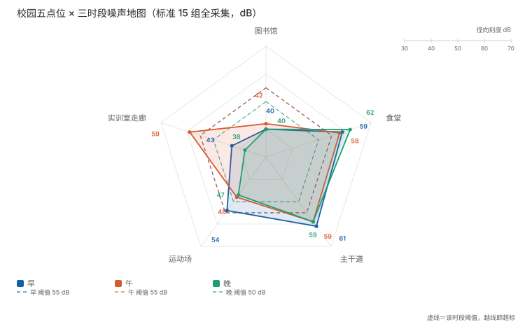
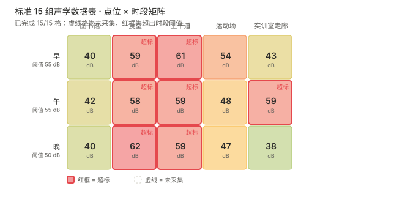
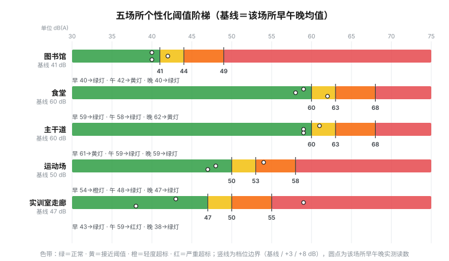
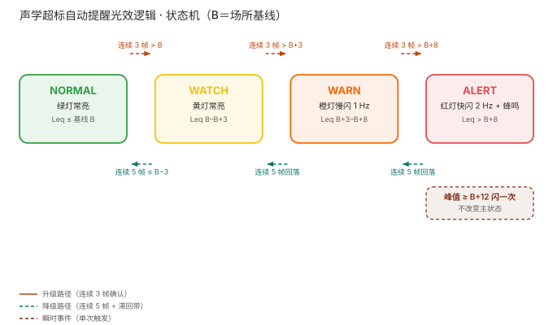
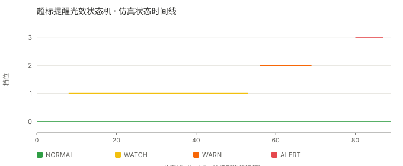
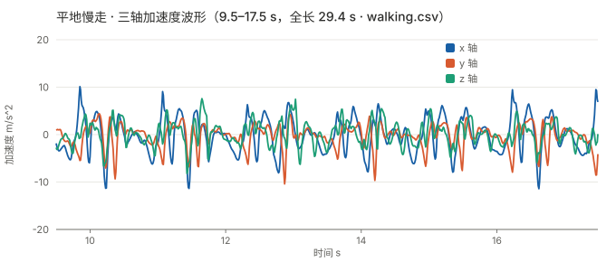
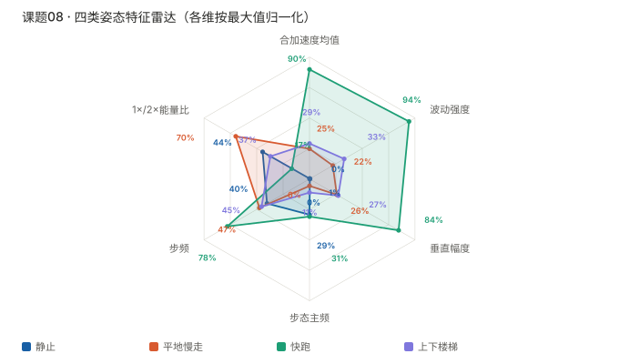
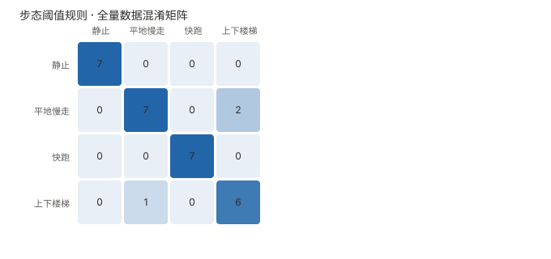

# 01 · Field Discovery｜第一阶段实地测评（课题 06 + 课题 08）

**参赛者**：王宇婷 · 2027094　**形式**：10 选 2，20 分　**要求**：提交本校实地采样的原始数据表、现场同框照片与可视化结果。

| 选题 | 交付要求 | 完成情况 |
|---|---|---|
| 课题 06 校园昼夜声学噪声地图测绘 | 15 组声学数据表、雷达图、声学超标自动提醒光效逻辑 | 标准 15 格全部有实测值；23 组纳入统计，11 组超时段阈值；五场所个性化四档光效 + 可运行状态机 |
| 课题 08 多姿态步态加速度特征采集与对比 | 4 份原始 CSV 波形、可视化图、区分动作的阈值规则 | 5 组 100 Hz 三轴 CSV（楼梯分快/慢）；四类判别规则；5 张波形 + 雷达 + 混淆矩阵 |

原始材料逐件说明见 [06-acoustic/README.md](./06-acoustic/README.md)、[08-gait/README.md](./08-gait/README.md)，交付逐条对照见 [08-gait/交付清单.md](./08-gait/交付清单.md)。

---

## 一、课题 06 · 校园昼夜声学噪声地图测绘

### 1.1 采集方案

| 项 | 内容 |
|---|---|
| 设备 / App | OPPO Reno 15 ＋「分贝仪噪音检测 PLW110」，导出含 min/max/avg、GPS、检测时间的报告 |
| 点位 | 图书馆、食堂、主干道、运动场、实训室走廊（官网指定 5 处） |
| 时段 | 早 07:00–09:00、午 11:00–14:00、晚 20:00–22:00；每处每时段 30–60 s |
| 控制变量 | 同一手机、同一持握高度（约 1.2 m）、同一朝向；避开出风口与手机壳遮挡；同步记录天气与校园活动 |
| 现场证据 | 水印相机 JPG / MP4 + App 报告 PNG，三者文件名一一对应 |

### 1.2 数据登记与口径

`raw_data/noise_log.csv` 共 36 行：`N01–N15` 为标准格（全部填满），`H01–H20` 与 `H05L` 为 21 组实测记录。**24 组独立实测、23 组纳入统计**（15 组归入标准格、8 组为佐证）；`H04`（min 7 dB）为 App 启动爬升假值，原件保留、仅作排障样本。数据覆盖 11/04、11/05、11/13、11/18、11/19、11/20、11/23。

标准格归位由 [tools/build_standard_grid.py](../tools/build_standard_grid.py) 完成，四条规则事先声明、幂等可复现：

| 规则 | 内容 |
|---|---|
| R1 时段合规 | 检测时刻落在早 07:00–09:00 / 午 11:00–14:00 / 晚 20:00–22:00 |
| R2 点位合规 | 与官网 5 点位一一对应：运动场 = 操场；实训室走廊 = 实验室走廊（门牌「426 产业项目实训室」「425 智能制造实训室」） |
| R3 同格多候选 | 优先取 min ≥ 15 dB（排除启动假值）者，并列取检测时间最早者；与声级高低无关 |
| R4 数值处理 | 从来源记录逐字段复制，不做平均、修正或再加工 |

15 格平均声级 dB(A)，加粗为超时段阈值（早/午 55 dB、晚 50 dB）：

| 时段 | 图书馆 | 食堂 | 主干道 | 运动场 | 实训室走廊 |
|---|---|---|---|---|---|
| 早 | 40 | **59** | **61** | 54 | 43 |
| 午 | 42 | **58** | **59** | 48 | **59** |
| 晚 | 40 | **62** | **59** | 47 | 38 |

7 格超标：食堂与主干道两处三个时段全部超标（6 格），另加实训室走廊午间 59 dB（下课人流）。图书馆午间为 11-23 12:19 重测值（38/48/42 dB，28 s），替代 11-05 那组 min 7 dB 记录；两者均值差 1 dB，新数据曲线自 38 dB 正常起步，可直接进统计。

### 1.3 结果

**五点位 × 三时段噪声地图**（虚线为时段阈值，越线即超标）：



**点位 × 时段矩阵**（红框为超标格）：



**五场所个性化阈值阶梯**：



**超标提醒光效状态机**：



**状态仿真时间线**：



结果文件与逐件说明见 [06-acoustic/README.md](./06-acoustic/README.md) 第 5.4 节；汇总表为 `results/06_summary.csv`（23 组纳入统计）。

### 1.4 光效逻辑

判据不用跨场所统一的绝对声级——五个点位本底相差 19 dB，统一阈值会让安静场所终年绿灯、嘈杂场所终年红灯。改用**该场所早/午/晚实测均值为基线 B**，叠加固定偏移：

| 场所 | 基线 B | 黄灯起 | 橙灯起 | 红灯起 | 峰值触发 |
|---|---:|---:|---:|---:|---:|
| 图书馆 | 41 | 44 | 49 | >49 | ≥53 |
| 食堂 | 60 | 63 | 68 | >68 | ≥72 |
| 主干道 | 60 | 63 | 68 | >68 | ≥72 |
| 运动场 | 50 | 53 | 58 | >58 | ≥62 |
| 实训室走廊 | 47 | 50 | 55 | >55 | ≥59 |

四档光效 `NORMAL 绿常亮 → WATCH 黄常亮 → WARN 橙慢闪 1 Hz → ALERT 红快闪 2 Hz + 蜂鸣`；瞬时峰值 ≥ B+12 dB 时红灯闪一次并记事件，不改变主状态。防抖：升级连续 3 帧确认、降级连续 5 帧确认、3 dB 滞回带。15 格实测回放为绿 10 · 黄 3 · 橙 1 · 红 1。

实现见 `analyze_noise.py` 的 `LightAlertFSM`；逐场所方案见 [06_alert_profiles.md](./results/06_alert_profiles.md)，通用逻辑见 [06_alert_logic.md](./results/06_alert_logic.md)。

**已知偏差**：实训室走廊午间 59 dB 相对其 47 dB 基线高出 12 dB，会触发红灯。该点位若长期部署，应对午间加时段偏置或改用同时段历史基线——已列入方案文档的优化项。

### 1.5 适用边界

- App 非专业声级计，未做 A 计权校准，读数存在系统误差；结论只用于同一设备下的相对比较，不作绝对声环境合规判定。
- `H04`（7 dB）、`H15`（18 dB）最小值为启动爬升假值，平均值可用、最小值不进统计。
- `H08`（17:10）、`H16`（17:58）文件名标「晚」，检测时刻未达 20:00–22:00，只作佐证、不占标准格。
- 门牌证据只证明走廊属实训楼，未证明左右两段为同一测点；按 R3 统一取右段。
- 有条件时用标准声级计做同点位对照并给修正系数，可提升可信度。

---

## 二、课题 08 · 多姿态步态加速度特征采集与对比

### 2.1 采集

| 项 | 内容 |
|---|---|
| 时间 | 2026-11-16 17:02–17:16；快跑 11/19 重采 |
| 设备 | 静止/慢走/爬楼：iPhone17,2 + phyphox 1.2.1；快跑重采：iPhone18,3（iOS 26.1） |
| 实验 | `Acceleration (without g)` 导出 `Linear Acceleration x/y/z`，已去重力，单位 m/s² |
| 姿态 | 静止、平地慢走、快跑、上下楼梯（快、慢两档）—— 比官网 4 类多采一档楼梯速度 |
| 证据 | 每组 CSV + MP4（App 实时曲线录屏）+ `meta/device.csv` + `meta/time.csv` |
| 采样 | 间隔中位数 0.0100 s ≈ 100 Hz，无丢帧、无时间倒序、无大段缺失 |

机型差异影响幅度类特征（`svm_mean` / `az_range`），两类数据分列说明；`without g` 数据不再减 9.81。

### 2.2 数据核对

依据 [课题08核对报告.html](../03-AI-Collaboration/第一阶段/课题08核对报告.html)：`|a| = √(x²+y²+z²)` 五份 CSV 逐行误差为 0，无整行重复，5 份 CSV 之间无复制粘贴。

| 组别 | CSV 时长 | 视频时长 | 差值 | \|a\| RMS | 峰值 | 判定 |
|---|---:|---:|---:|---:|---:|---|
| 静止 | 21.75 s | 17.93 s | −3.81 s | 0.12 | 2.0 | 配对正确 |
| 慢走 | 29.36 s | 31.37 s | +2.01 s | 5.46 | 22.3 | 配对正确；视频 UI 遮挡曲线 |
| 快跑（11/16 旧版） | 3.88 s | 15.77 s | +11.89 s | 1.93 | 5.2 | 无效（暂停 25.13 s，强度逐秒衰减） |
| 爬楼梯（慢） | 21.95 s | 17.53 s | −4.42 s | 3.47 | 15.8 | 配对正确；16 s 后无动作 |
| 爬楼梯（快） | 13.97 s | 15.43 s | +1.46 s | 9.61 | 48.9 | 配对正确 |

快跑 11/19 重采后：31.98 s / 100 Hz / 无暂停，RMS 17.31、峰值 73.6，恢复为有效样本。录屏与采集独立起停（差 −4.42 ~ +11.89 s），不做逐秒对齐；采集时刻只认 `meta/time.csv` 与画面状态栏。

### 2.3 特征与阈值

3 s 滑窗，10 个可解释特征：

| 类别 | 特征 |
|---|---|
| 时域 | 合加速度均值 `svm_mean`、波动 `svm_std`、垂直幅度 `az_range`（95–5 分位）、过零率 `zcr` |
| 频域 | 主频 `dominant_hz`（FFT + 512 点零填充）、频谱质心 `centroid` |
| 步态节律 | 步频 `cadence`、步频规整度 `cad_cv`、峰值对齐度 `align`、1×/2× 步频能量比 `ratio` |

无效样本按有效时长 < 12 s 客观判定；活动段双向裁剪，去掉开头未起步与末尾已放下段；阈值由训练窗口标定（两类均值中点），测试窗口不参与。

```python
if svm_mean < 2.462:            静止     # 合加速度趋零
elif svm_mean >= 11.694:        快跑     # 冲击量级高
elif ratio < 1.393:             上下楼梯 # 单脚支撑，垂向力集中 1× 步频
else:                           平地慢走 # 双脚交替，能量落在 2× 步频
```

### 2.4 结果

**波形**：五个源文件各一张，均取活动段中部 8 s（非文件开头——开头常是「已就位但尚未起步」的准备段），标题标注实际区间与源文件名，可逐张复核。此处列平地慢走，其余四张见 `results/`：

`08_wave_静止.svg` · `08_wave_快跑.svg` · `08_wave_上下楼梯_快.svg` · `08_wave_上下楼梯_慢.svg`



**特征雷达图与混淆矩阵**：





| 指标 | 结果 | 口径 |
|---|---|---|
| 参与姿态 / 有效窗口 | 4 类齐全 / 30 个窗口 | 3 s 窗口、双向裁剪后 |
| 重复分层 5 折交叉验证 | **88.3%** | 4 种子 × 20 轮 = 120 次评估；同次采集窗口级可分性，偏乐观 |
| 留一整份源文件 | **63.3%** | 训练与测试不共享录音，更接近泛化；留出快跑文件 0/7（仅 1 份源文件，阈值无从标定） |
| 主要混淆 | 平地慢走 ↔ 上下楼梯 | 两类垂向幅度分布重叠，故用节奏判据 |

特征表 `results/08_features.csv`（30 窗口）、阈值详情 [08_threshold_rules.md](./results/08_threshold_rules.md)。

### 2.5 适用边界

- 每类仅 1 次采集（快跑为 11/19 重采版），无法估计类内波动——K 折与留一文件差距大的直接原因。
- 手机固定位置未写入当天日志；幅度类特征对位置敏感。
- 快跑机型（iPhone18,3）与其余四组（iPhone17,2）不同，幅度特征存在系统差异。
- 上下楼梯类内强度跨 2.4 倍（慢 2.54 ↔ 快 6.89），单次采集无法估计类内方差，是「平地慢走 ↔ 上下楼梯」混淆的主要来源。

---

## 三、官网交付对照

| 官网要求 | 本目录对应 | 状态 |
|---|---|---|
| 课题 06：15 组声学数据表 | `noise_log.csv` | 标准格 15/15 |
| 课题 06：雷达图 | `results/06_noise_radar.svg` + `06_noise_matrix.svg` | 5×3 矩阵完整 |
| 课题 06：超标光效逻辑 | `results/06_alert_profiles.md` + `06_alert_logic.md` + `06_alert_fsm.svg` + `LightAlertFSM` | 五套方案 + 四档状态机 + 可运行代码 |
| 课题 06：现场照片 | `raw_data/acoustic/*.jpg`、`*.mp4` | 各组对应齐全 |
| 课题 08：4 份原始 CSV 波形 | `raw_data/gait/*/` 5 组 CSV + `results/08_wave_*.svg` | 4 类齐全，快跑重采有效 |
| 课题 08：可视化图 | `results/08_wave_*.svg`（5 张）、`08_radar.svg`、`08_feature_bars.svg`、`08_confusion.svg` | 齐 |
| 课题 08：阈值规则 | `results/08_threshold_rules.md`、`08-gait/交付清单.md` | 真实数据标定，88.3% / 63.3% |
| 过程留痕 | `../02-20Days-Challenge/process_logs/`、`../03-AI-Collaboration/` | 截图与核对报告齐 |

## 四、复现

```bat
python tools\build_standard_grid.py
python 01-Field-Discovery\analyze_noise.py
python 01-Field-Discovery\analyze_gait.py
```
