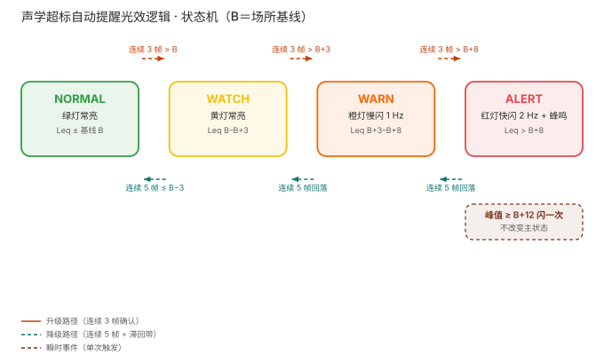
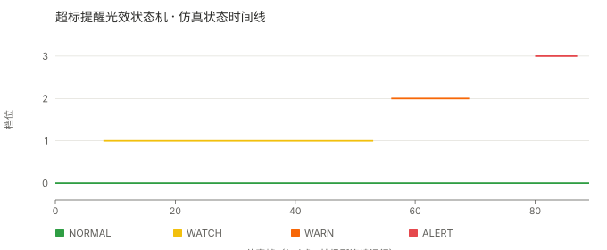

# 课题 06 · 声学超标自动提醒光效逻辑

> 由 `analyze_noise.py` 生成。本文给出通用光效逻辑与防抖参数；五个采集场所各自的基线阈值与针对性方案见 `06_alert_profiles.md`。



## 一、设计目标

校园噪声提醒最容易失效的方式是「一超就红、一降就绿」：读数在阈值附近来回跳，灯色反复切换，看的人反而抓不住真正的超标。本逻辑解决三件事：

1. **不抖**——连续 N 帧确认 + 滞回带，把临界波动滤掉；
2. **看得懂**——四档颜色对应严重程度（绿/黄/橙/红），一眼判断该不该处理；
3. **不漏报**——瞬时尖峰（关门、拖椅、刹车）即使等效声级未超也触发单次闪灯并记录。

## 二、阈值来源

判据不用跨场所统一的绝对声级，而以**该场所早/午/晚实测均值为基线 B**，向上叠加固定偏移（+3 / +8 / +12 dB）。五个点位的本底相差 19 dB，统一阈值会让安静场所终年绿灯、嘈杂场所终年红灯。

| 场所 | 早 | 午 | 晚 | 基线 B | 黄灯起 | 橙灯起 | 红灯起 | 峰值触发 |
|---|---:|---:|---:|---:|---:|---:|---:|---:|
| 图书馆 | 40 | 42 | 40 | **41** | 44 | 49 | >49 | ≥53 |
| 食堂 | 59 | 58 | 62 | **60** | 63 | 68 | >68 | ≥72 |
| 主干道 | 61 | 59 | 59 | **60** | 63 | 68 | >68 | ≥72 |
| 运动场 | 54 | 48 | 47 | **50** | 53 | 58 | >58 | ≥62 |
| 实训室走廊 | 43 | 59 | 38 | **47** | 50 | 55 | >55 | ≥59 |

基线取整到 1 dB，便于设备内置参数表。场地功能定位不同，同一基线的含义也不同：
图书馆的 41 dB 是「安静优先」，食堂的 60 dB 是「人声常态」，两者都用各自本底作参照，越线才代表偏离其正常水平。

> 参考：GB 3096-2008《声环境质量标准》1 类区昼间限值 55 dB。本方案对图书馆、实训室走廊等安静点位的要求严于该限值（基线 41 / 47 dB），对食堂、主干道则以本底为基准——这两处的 55 dB 会在整个用餐高峰持续被突破，不具备提醒价值。

## 三、四档光效

| 档位 | 光效 | 判据（Leq = 滑动 60 s 等效声级） | 动作 |
|---|---|---|---|
| NORMAL | **绿灯常亮** | Leq ≤ B | 仅上报 |
| WATCH | **黄灯常亮** | B < Leq ≤ B+3 | 上报 + 提示 |
| WARN | **橙灯慢闪 1 Hz** | B+3 < Leq ≤ B+8 | 上报 + 记录事件 |
| ALERT | **红灯快闪 2 Hz + 蜂鸣** | Leq > B+8 | 上报 + 记录 + 现场提醒 |
| 峰值 | **红灯闪一次** | 瞬时 max ≥ B+12 | 记录峰值时刻与数值，不改变主状态 |

- 升级确认 3 帧（3 s）、降级确认 5 帧（5 s）、滞回带 3 dB
- 采样周期 1 s，取滑动 60 s 等效声级；峰值取 1 s 内最大值
- 实现见 `analyze_noise.py` 的 `LightAlertFSM` 类，是可运行代码而非伪代码

### 三个参数为什么这么定

| 参数 | 取值 | 理由 |
|---|---|---|
| 升级确认 | 3 帧（3 s） | 单帧可能撞上关门、拖椅；连续 3 帧越线才算真实超标 |
| 降级确认 | 5 帧（5 s） | 比升级慢，是刻意的：超标后不应立刻降级，留出处理时间 |
| 滞回带 | 3.0 dB | 升级线 B、降级线 B−3 分设，两个方向不共用同一条线 |
| 峰值偏移 | +12 dB | 差 12 dB 的尖峰在 A 计权下响度相差约 16 倍，不能与稳态声级混为一谈 |



```python
if peak >= B + 12: emit(PEAK_FLASH)          # 闪一次并记录，不改主状态
tgt = NORMAL if leq <= B else WATCH if leq <= B+3 else WARN if leq <= B+8 else ALERT
if tgt > state:                              # 升级：连续 3 帧
    up += 1; down = 0
    if up >= 3: state = tgt; up = 0
elif tgt < state and leq <= upper_of(tgt) - 3:   # 降级：连续 5 帧，且需落入滞回带
    down += 1; up = 0
    if down >= 5: state = tgt; down = 0
```

## 四、仿真结果

- 输入：23 组真实实测，按五个场各自的基线运行 90 帧（1 s/帧）
- 状态切换 7 次，峰值短闪 9 次

| 帧 | 切换 | 依据 |
|---|---|---|
| 8 | NORMAL->WATCH | Leq 42 dB / 基线 41 dB |
| 32 | NORMAL->WATCH | Leq 62 dB / 基线 60 dB |
| 38 | NORMAL->WATCH | Leq 61 dB / 基线 60 dB |
| 56 | NORMAL->WARN | Leq 54 dB / 基线 50 dB |
| 70 | WARN->NORMAL | Leq 47 dB / 基线 50 dB |
| 80 | NORMAL->ALERT | Leq 59 dB / 基线 47 dB |
| 88 | ALERT->NORMAL | Leq 38 dB / 基线 47 dB |

## 五、数据边界

- 手机 App 非专业声级计、未做 A 计权校准：全程同一台设备、同一持握高度与朝向，系统误差在场所间保持一致，因此「相对基线的偏离」比「绝对声级」更可靠。
- `H04`（min 7 dB）、`H15`（min 18 dB）为 App 启动瞬间麦克风未稳定的爬升假值，原始记录保留不删不改，已列为排障样本，不参与声级统计。
- 雨天与校园活动会抬高食堂、运动场读数，CSV 的 `weather` / `note` 列留有归因字段。
- 状态机未接真实硬件：仿真由实测数据驱动，光效输出为状态字符串；接 WS2812 灯环时把 `LIGHT[state]` 映射为 RGB 与闪烁频率，状态机逻辑无需改动。
