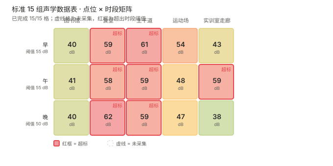
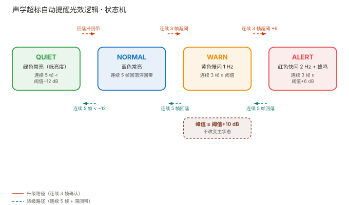
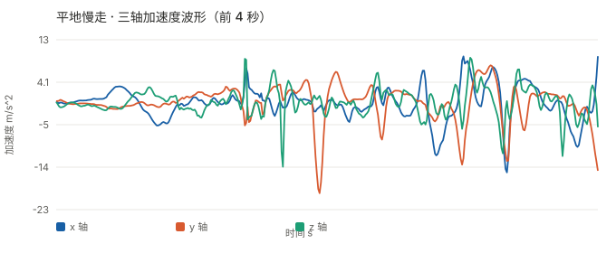
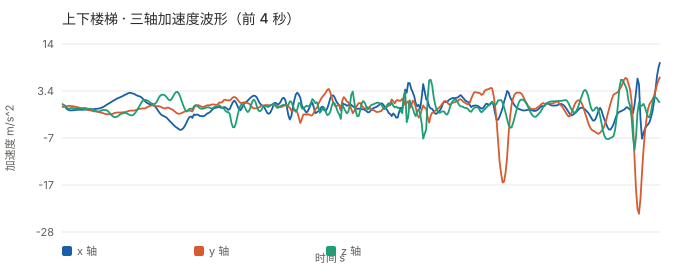
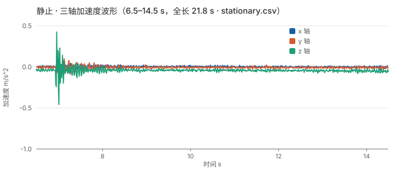
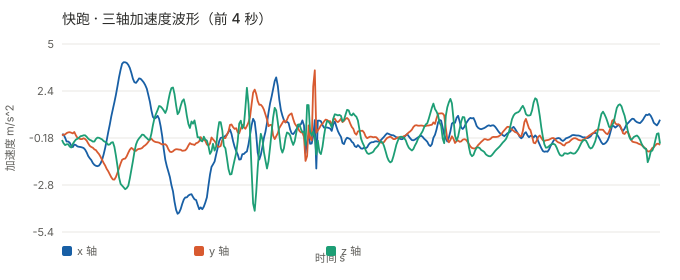
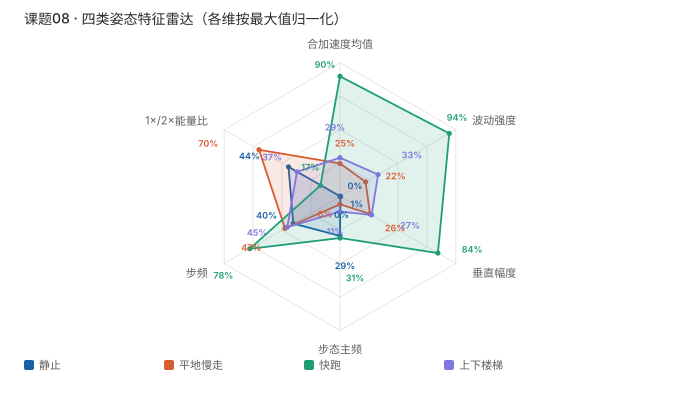
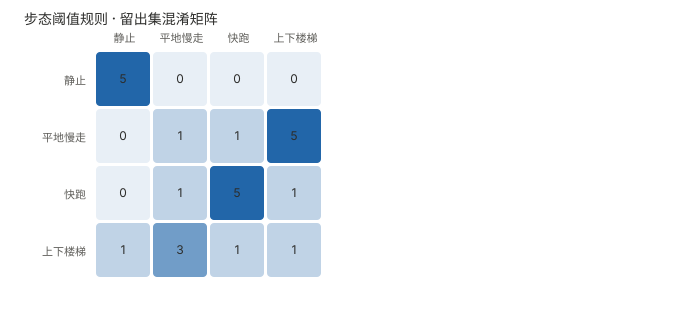

# 第一阶段 · 基础素养实地测评（课题 06 + 课题 08）

**学号**：2027094　**姓名**：王宇婷
**要求**：10 选 2，20 分；提交本校实地采样原始数据表、现场同框照片与可视化结果。

| 选题 | 交付要求 | 成果 |
|---|---|---|
| 课题 06 校园昼夜声学噪声地图测绘 | 15 组声学数据表 + 雷达图 + 声学超标自动提醒光效逻辑 | 23 次独立实测 + 起点 3 份佐证；标准 15 格全满（早/午/晚各 5/5），雷达图与矩阵图无空缺 |
| 课题 08 多姿态步态加速度特征采集与对比 | 4 份原始 CSV 波形 + 可视化图 + 区分动作的阈值规则 | 5 组真实 CSV + 录屏 + meta；4 类波形图、雷达图、阈值规则齐全 |

原始材料逐件说明见 [课题06/README.md](./课题06/README.md) 与 [课题08/README.md](./课题08/README.md)。

---

## 课题 06 · 校园昼夜声学噪声地图测绘

### 采集方案

| 项 | 内容 |
|---|---|
| 设备 / APP | OPPO Reno 15 ＋「分贝仪噪音检测（PLW110）」App，导出含 min/max/avg、GPS、检测时间的报告 |
| 点位 | 图书馆、食堂、主干道、运动场、实训室走廊（官网 5 处） |
| 时段 | 早 07:00–09:00、午 11:00–14:00、晚 20:00–22:00，每处每时段 30–60 s |
| 控制变量 | 同一手机、同一持握高度（约 1.2 m）、同一朝向，避开出风口与手机壳遮挡；记录天气与校园活动 |
| 现场证据 | 每点位 JPG / MP4 水印照，报告存 PNG，三者文件名一一对应 |

### 数据登记

`noise_log.csv` 共 36 行：`N01–N15` 为官网标准格（全部填满），`H01–H19` + `H05L` 为实测与补测记录，`R01` 为对照格（未测）。23 次独立实测，覆盖 11/04、11/05、11/13、11/18、11/19、11/20。

标准 15 格的归位由 [tools/build_standard_grid.py](../tools/build_standard_grid.py) 完成，四条规则事先声明、幂等可复现：

| 规则 | 内容 |
|---|---|
| R1 时段合规 | 检测时刻落在早 07:00–09:00 / 午 11:00–14:00 / 晚 20:00–22:00 |
| R2 点位合规 | 与官网 5 点位一一对应：运动场 = 操场；实训室走廊 = 实验室走廊（门牌「426 产业项目实训室」「425 智能制造实训室」） |
| R3 同格多候选 | 优先取 min ≥ 15 dB（排除 App 启动爬升假值）者，并列取检测时间最早者；与声级高低无关 |
| R4 数值处理 | 从来源记录逐字段复制，不做平均、修正或再加工 |

15 格平均声级（dB(A)）：

| 时段 | 图书馆 | 食堂 | 主干道 | 运动场 | 实训室走廊 |
|---|---|---|---|---|---|
| 早 | 40 | **59** | **61** | 54 | 43 |
| 午 | 41 | **58** | **59** | 48 | **59** |
| 晚 | 40 | **62** | **59** | 47 | 38 |

阈值：早/午 55 dB、晚 50 dB。7 格超标，集中在食堂与主干道（两处三个时段全部超标）。

### 分析结果

**五点位 × 三时段噪声地图雷达图**（五轴 = 点位，三折线 = 时段，虚线 = 阈值，越线即超标）：


**点位 × 时段矩阵热力图**（红框 = 超标）：



**超标提醒光效状态机**（四态框 + 升级/降级箭头 + 条件标签）：



**光效状态仿真时间线**：


| 文件 | 内容 |
|---|---|
| `results/06_summary.csv` | 汇总表：阈值、超标分贝数、超标判定、异常标记（23 行，不重复计数） |
| `results/06_noise_bars.svg` | 各记录平均声级柱状图 |
| `results/06_noise_radar.svg` | 5 点位 × 3 时段雷达图，15 格全有实测值 |
| `results/06_noise_matrix.svg` | 矩阵热力图，超标格红框 |
| `results/06_alert_fsm.svg` | 光效状态机转移图 |
| `results/06_alert_timeline.svg` | 状态仿真时间线 |
| `results/06_alert_logic.md` | 光效逻辑完整说明：伪代码、参数取值、仿真结果 |

### 光效逻辑

阈值按教学区管理值设定：早/午 55 dB、晚 50 dB（参考 GB 3096 1 类区昼间 55 dB，晚间校园自习时段自定收紧）。

四态：`QUIET 绿常亮 → NORMAL 蓝常亮 → WARN 黄慢闪 1 Hz → ALERT 红快闪 2 Hz + 蜂鸣`。

防抖参数：升级连续 3 帧确认、降级连续 5 帧确认、3 dB 滞回带；瞬时峰值超阈值 +10 dB 触发单次短闪，不改变主状态。完整伪代码与仿真见 `results/06_alert_logic.md`，实现见 `analyze_noise.py` 的 `LightAlertFSM`。

### 已知局限

- 手机 App 非专业声级计，未做 A 计权校准，读数存在系统误差；结论只用于同一设备下的相对比较，不作绝对声环境合规判定。
- H04（7 dB）、H15（18 dB）最小值为 App 启动爬升假值，平均值可用、最小值不进统计，原始记录保留并标注。
- H08（17:10）、H16（17:58）文件名标「晚」，检测时刻未达官网 20:00–22:00，只作佐证、不占标准格。
- 门牌证据确认走廊属实训楼，未证明左右两段为同一测点；归位按 R3 统一取右段。
- 有条件时用标准声级计做同点位对照、给出修正系数，可提升可信度。

---

## 课题 08 · 多姿态步态加速度特征采集与对比

### 采集

| 项 | 内容 |
|---|---|
| 时间 | 2026-11-16 17:02–17:16；快跑 11/19 重采 |
| 设备 | 静止/慢走/爬楼梯：iPhone17,2 + phyphox 1.2.1；快跑重采：iPhone18,3（iOS 26.1） |
| 实验 | `Acceleration (without g)` 导出的 `Linear Acceleration x/y/z`，已去重力，单位 m/s² |
| 姿态 | 静止、平地慢走、快跑、上下楼梯（快、慢两档）—— 比官网 4 类多采一档楼梯速度 |
| 证据 | 每组 CSV + MP4（App 实时曲线录屏）+ `meta/device.csv` + `meta/time.csv` |
| 采样 | 间隔中位数 0.0100 s ≈ 100 Hz，无丢帧、无时间倒序、无大段缺失 |

机型差异影响幅度类特征（`svm_mean` / `az_range`），两类数据分列说明。`without g` 数据不再做减 9.81 去重力。

### 原始数据

```
课题08/
├── 静止/          stationary.csv · stationary.mp4 · meta/{device,time}.csv
├── 慢走/          walking.csv    · walking.mp4    · meta/
├── 快跑/          Raw Data.csv   · 2bd3988d….mp4  · meta/     ← 11-19 重采，31.98 s 有效
├── 爬楼梯（慢）/   stairs-slow.csv · stairs-slow.mp4 · meta/
└── 爬楼梯（快）/   stairs-fast.csv · stairs-fast.mp4 · meta/
```

| 列名 | 含义 | 单位 |
|---|---|---|
| `Time (s)` | 实验相对时间（暂停期间不计时） | s |
| `Linear Acceleration x/y/z (m/s^2)` | 三轴线性加速度，已去重力 | m/s² |
| `Absolute acceleration (m/s^2)` | 合加速度 √(x²+y²+z²) | m/s² |

`meta/time.csv` 记录 START / PAUSE 事件与墙钟时刻；CSV 末时刻与末次 PAUSE 的实验时间差 0.004–0.023 s，导出完整。5 份 `device.csv` MD5 相同，视频均为 592×1280 / 30 fps / HEVC + AAC。

### 数据核对

[课题08核对报告.html](../AI使用报告/第一阶段/课题08核对报告.html) 完成 CSV ↔ 视频交叉核对（`|a| = √(x²+y²+z²)` 逐行误差为 0，5 份 CSV 无整行重复）。

| 组别 | CSV 时长 | 视频时长 | 差值 | \|a\| RMS | 峰值 | 判定 |
|---|---:|---:|---:|---:|---:|---|
| 静止 | 21.75 s | 17.93 s | −3.81 s | 0.12 | 2.0 | 配对正确 |
| 慢走 | 29.36 s | 31.37 s | +2.01 s | 5.46 | 22.3 | 配对正确；视频 UI 遮挡曲线 |
| 快跑（11/16 旧版） | 3.88 s | 15.77 s | +11.89 s | 1.93 | 5.2 | 无效（暂停 25.13 s，逐秒强度衰减） |
| 爬楼梯（慢） | 21.95 s | 17.53 s | −4.42 s | 3.47 | 15.8 | 配对正确；16 s 后无动作 |
| 爬楼梯（快） | 13.97 s | 15.43 s | +1.46 s | 9.61 | 48.9 | 配对正确 |

快跑 11/19 重采后：31.98 s / 100 Hz / 无暂停，RMS 17.31、峰值 73.6，恢复有效样本。旧版数值与判定理由以文字留存。

录屏与采集独立起停，时长差 −4.42 ~ +11.89 s，不做逐秒对齐；采集时刻以 `meta/time.csv` 与画面状态栏为准，文件时间戳不可用。

### 特征与阈值

3 秒滑窗，提取 10 个可解释特征：

| 类别 | 特征 |
|---|---|
| 时域 | 合加速度均值 `svm_mean`、波动 `svm_std`、垂直幅度 `az_range`（95–5 分位）、过零率 `zcr` |
| 频域 | 主频 `dominant_hz`（FFT + 512 点零填充）、频谱质心 `centroid` |
| 步态节律 | 步频 `cadence`、步频规整度 `cad_cv`、峰值对齐度 `align`、1×/2× 步频能量比 `ratio` |

无效样本按有效时长 < 12 s 客观判定；活动段双向裁剪，去掉开头未起跑与末尾已放下的非动作段；阈值由训练窗口自动标定（取两类均值中点），测试窗口不参与。

判别规则：

```python
if svm_mean < 2.462:            静止     # 合加速度趋零
elif svm_mean >= 11.694:        快跑     # 冲击量级高
elif ratio < 1.393:             上下楼梯 # 单脚支撑，垂向力集中 1× 步频
else:                           平地慢走 # 双脚交替，能量落在 2× 步频
```

### 分析结果

**四类步态波形**：









**四类特征雷达图**：



**混淆矩阵**：



| 文件 | 内容 |
|---|---|
| `results/08_features.csv` | 逐窗口特征表（30 个窗口） |
| `results/08_wave_*.svg` | 三轴加速度波形（5 张） |
| `results/08_radar.svg` / `08_feature_bars.svg` | 特征雷达图 / 贡献对比 |
| `results/08_confusion.svg` | 混淆矩阵 |
| `results/08_threshold_rules.md` | 阈值、准确率、各姿态特征均值、裁尾记录 |

| 指标 | 11/22 结果 |
|---|---|
| 参与姿态 | 4 类齐全，30 个有效窗口 |
| 重复分层 5 折交叉验证 | **88.3%**（120 次评估） |
| 留一整份源文件 | **63.3%**（30 窗口） |
| 主要混淆 | 平地慢走 ↔ 上下楼梯 |

88.3% 衡量同次采集的窗口级可分性（同文件窗口相似，偏乐观）；63.3% 为留一整份源文件结果，更接近泛化。留出快跑文件正确率 0/7，因快跑仅 1 份源文件、训练集不含该类，阈值无从标定。

### 已知局限

- 每类仅 1 次采集（快跑为 11/19 重采版），无法估计类内波动；这是 K 折与留一文件结果差距大的直接原因。
- 手机固定位置未写入当天日志；幅度类特征对位置敏感。
- 快跑机型（iPhone18,3）与其余四组（iPhone17,2）不同，幅度特征存在系统差异。
- 上下楼梯类内强度跨 2.4 倍（慢 2.54 ↔ 快 6.89），单次采集无法估计类内方差，是「平地慢走 ↔ 上下楼梯」混淆的主要来源。

---

## 官网交付对照

| 官网要求 | 本目录对应 | 状态 |
|---|---|---|
| 课题 06：15 组声学数据表 | `noise_log.csv` | 标准格 15/15 全满 |
| 课题 06：雷达图 | `results/06_noise_radar.svg` + `06_noise_matrix.svg` | 完整 5×3 矩阵 |
| 课题 06：超标光效逻辑 | `results/06_alert_logic.md` + `06_alert_fsm.svg` + `LightAlertFSM` | 四态状态机 + 可运行代码 |
| 课题 06：现场照片 | `课题06/*.jpg` / `*.mp4` | 各组对应齐全 |
| 课题 08：4 份原始 CSV 波形 | `课题08/*/` 5 组 CSV + `results/08_wave_*.svg` | 4 类齐全，快跑重采有效 |
| 课题 08：可视化图 | `results/08_wave_*.svg`（5 张）、`08_radar.svg`、`08_feature_bars.svg`、`08_confusion.svg` | 齐 |
| 课题 08：阈值规则 | `results/08_threshold_rules.md`、`课题08/交付清单.md` | 真实数据标定，K 折 88.3% / 留一文件 63.3% |
| 两题过程留痕 | `../process_logs/`、`../AI使用报告/` | 截图与核对报告齐 |
