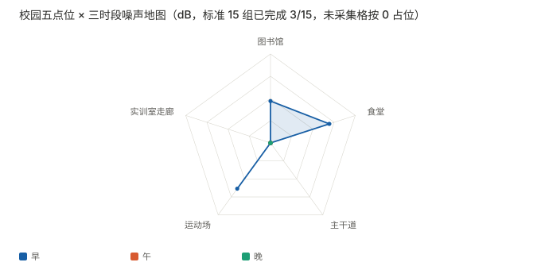
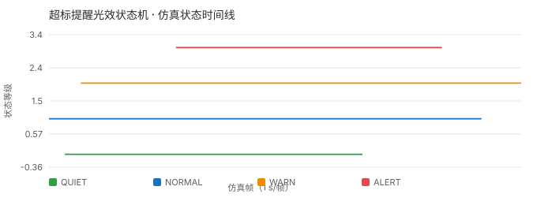

# 第一阶段 · 基础素养实地测评（课题 06 + 课题 08）

**学号**：2027094　**姓名**：王宇婷
**项目起点**：2026-11-01（项目三分贝交叉测量 + git 建仓）　**最近核对**：2026-11-22（标准格补登记 11-19 晚间三份报告后达成 **15/15**、门牌证据确认实训室走廊、脚本计数修正）
**要求**：10 选 2，占 20 分；零编程门槛，须提交本校实地采样**原始数据表**与**本人现场同框照片**。

| 选题 | 交付要求 | 当前状态 |
|---|---|---|
| 课题 06 校园昼夜声学噪声地图测绘 | 15 组声学数据表 + 雷达图 + 声学超标自动提醒光效逻辑 | ✅ 23 次独立实测（11/04–11/20）+ 项目起点 11/01 三份交叉佐证；**标准 15 格全采集 15/15**（早 5/5、午 5/5、晚 5/5），雷达图与热力图无空缺 |
| 课题 08 多姿态步态加速度特征采集与对比 | 4 份原始 CSV 波形 + 可视化图 + 区分动作的阈值规则 | ✅ 5 组真实 CSV + 录屏 + meta；4 类波形图/雷达图/阈值规则已出，**11-22 规则升级后 K 折 88.3% / 留一文件 63.3%** |

> 原始材料逐件说明见 [课题06/README.md](./课题06/README.md) 与 [课题08/README.md](./课题08/README.md)。
> 数据真实性核对见 [AI使用报告/第一阶段/课题08核对报告.html](../AI使用报告/第一阶段/课题08核对报告.html)。

---

## 课题 06 · 校园昼夜声学噪声地图测绘

### 采集方案
- **设备 / APP**：OPPO Reno 15 ＋「分贝仪噪音检测（PLW110）」App，能导出含最小/最大/平均分贝、GPS 地点与检测时间的报告 PNG。
- **点位**：图书馆、食堂、主干道、运动场、实训室走廊（官网 5 处）。
- **时段**：早 07:00–09:00、午 11:00–14:00、晚 20:00–22:00；每处每时段测 30–60 秒。
- **控制变量**：同一台手机、同一持握高度（约 1.2 m）、同一朝向、避开出风口与手机壳遮挡；记录天气与校园活动。
- **现场证据**：每个点位拍 JPG / MP4，报告存 PNG，三者文件名一一对应。

### 已采集数据（23 次独立实测，11/04–11/20）

**项目起点 11/01**：整个仓库最早的分贝实测在项目三目录，低速/高速/受阻三份报告（16:49/16:50/16:55，
平均 52→57→61 dB），比课题 06 首测早 3 天，也是 git 建仓当天。详见 [课题06/README.md 第三节](./课题06/README.md)。

#### 标准 15 格的归位（11-22 复核，3/15 → 12/15 → 15/15）

复核发现：**此前标准表只填 3/15，不代表只测了 3 组**。已有 20 次实测里，至少 9 组的**时段与点位本来就完全合规**，
只是当时被登记成「佐证」、没有归位到标准格，导致雷达图与热力图大半空白、完成度被低估。
新增 `tools/build_standard_grid.py` 按四条事先声明的规则重新归位（**幂等、可复现、只做归位不做加工**）：

| 规则 | 内容 |
|---|---|
| R1 时段合规 | 检测时刻落在 早 07:00–09:00 / 午 11:00–14:00 / 晚 20:00–22:00（官网只写「早/午/晚」，未给钟点，窗口口径见上） |
| R2 点位合规 | 实测点位与官网 5 点位一一对应：运动场 = 操场；**实训室走廊 = 实验室走廊**（门牌「426 产业项目实训室」「425 智能制造实训室」，与官网 426 实践工坊同址） |
| R3 同格多候选 | 优先取 min ≥ 15 dB（排除 App 启动爬升假值）者，仍并列则取检测时间最早者 —— **该规则与声级高低无关，不挑好看的数** |
| R4 数值处理 | 从来源记录逐字段复制，不做平均、修正或再加工 |

| 标准格 | 时段 | 点位 | min/max/avg dB | 来源 |
|---|---|---|---|---|
| N11 / N12 / N14 | 早 | 图书馆 / 食堂 / 运动场 | 38/49/40 · 53/73/59 · 45/70/54 | 11-20 直采 |
| N15 / N13 | 早 | 实训室走廊 / 主干道 | 39/53/43 · 54/78/61 | H11 / H13 |
| N01 / N02 / N03 | 午 | 图书馆 / 食堂 / 主干道 | 7/53/41 · 53/77/58 · 48/79/59 | H04 / H07 / H14 |
| N04 / N05 | 午 | 运动场 / 实训室走廊 | 44/57/48 · 55/66/59 | H06 / H05 |
| N07 / N10 | 晚 | 食堂 / 实训室走廊 | 53/79/62 · 35/44/38 | H09 / H03 |

**11-22 下午补登记的 3 格（晚图书馆 / 晚主干道 / 晚运动场）→ 15/15 全满**：
复核时发现 **11-19 晚间还有三份分贝报告此前完全未登记** —— 这三份报告的文件名带 `(2)` 后缀
（`11-19晚上图书馆 (2).jpg` 等），此前被误当成现场照片而漏登。逐张打开核对后确认**全部合规**：

| 新编号 | 报告文件 | 检测时间 | 点位 | min/max/avg dB | 现场水印核对 |
|---|---|---|---|---|---|
| H17 | `11-19晚上图书馆 (2).jpg` | 20:34 | 图书馆 | 37/58/40 | 水印 20:34、地点「深圳城市职业学院图书馆」—— **逐秒吻合** |
| H19 | `11-19晚上主干道 (2).jpg` | 20:41 | 主干道 | 49/71/59 | 水印 20:40、地点「学院干道」—— 差 1 分钟（先启动测量后取景拍照，同批次 H12 同口径） |
| H18 | `11-19晚上操场 (2).jpg` | 20:49 | 运动场 | 40/68/47 | 水印 20:49、地点「学院操场」—— **吻合** |

三份均落在晚 20:00–22:00 窗口内、水印直书对应点位，按 R1/R2/R4 归入 N06 / N08 / N09。
**H08（11/18 17:10）、H16（11/20 17:58）** 虽文件名标「晚」但未达 20:00–22:00，按 R1 仍不进标准格，只作佐证。

> **漏登原因**：此前逐张核对时按「文件名含『分贝报告』样式」筛选，遗漏了 `(2)` 命名的三份。
> 教训是**不能靠文件名筛选原始数据**——本次已改为把课题 06 目录下全部 11 份报告（含 10 份 `(2).jpg` 与 11 份 `.png`）逐张打开核对，数值与时间逐条回填。

**11/20 新增 10 份**：逐张核对数值与现场水印时刻全部吻合、数据真实。其中 3 份（早 × 图书馆 08:27 / 食堂 08:16 / 运动场 08:20）直接填入标准格 N11/N12/N14；其余 7 份登记为 H10–H16，其中 H13（08:42 主干道校外）按 R1/R2 归入 N13。
H15 中午主干道校外最小 18 dB、H16 晚主干道 17:58 是两处已知数据边界：前者属 App 启动爬升假值（平均值 60 可用、最小值不进统计），后者未达官网 20:00–22:00 晚间标准，均如实标注、不进标准格。

**11/18 新增 4 组（H06–H09）**：操场午 44/57/48、食堂午 53/77/58、主干道 54/67/59、食堂晚 53/79/62 dB，每组含报告 + 现场水印照 + MP4。
逐张核对后确认：**报告的 App 检测时间与现场水印照时刻全部吻合，点位归属正确、无文件名与内容对调**。
报告里的场景标签（食堂写「汽车穿梭在马路上」等）是 App 按分贝套的模板文案，非真实点位，详见 [课题06/README.md](./课题06/README.md)。

| 编号 | 时间 | 点位 | 最小 dB | 最大 dB | 平均 dB | 报告文件 |
|---|---|---|---:|---:|---:|---|
| H01 | 11/04 17:46 | 图书馆一楼 | 36 | 54 | 41 | `课题06/11-4下午图书馆一楼.png` |
| H02 | 11/04 20:32 | 实验室走廊左 | 35 | 46 | 39 | `课题06/11-4晚上实验室走廊左边.png` |
| H03 | 11/04 20:33 | 实验室走廊右 | 35 | 44 | 38 | `课题06/11-4晚上实验室走廊右边.png` |
| H04 | 11/05 11:50 | 图书馆一楼 | **7** | 53 | 41 | `课题06/11-5中午图书馆一楼..png` |
| H05L | 11/13 11:41 | 实验室走廊左 | 55 | 70 | **60** | `课题06/11-13中午实验室走廊左边 .jpg`（末尾带空格，是报告） |
| H05 | 11/13 11:42 | 实验室走廊右 | 55 | 66 | **59** | `课题06/11-13中午实验室走廊右边.png` |

**H04 异常值归因（面试重点）**：最小 7 dB 明显违背室内环境常识，报告曲线从约 6 dB 起步后迅速爬升至 41 dB 平台，判定为 **App 启动瞬间麦克风增益尚未稳定的爬升假值**。处理方式：**保留原始 PNG 与数值不删不改**，在 `noise_log.csv` 标注 `已有-异常`，平均值 41 dB 与同点位 H01 一致、仍可参考，最小值不纳入统计。同类还有 11/20 的 H15（18 dB），处理一致。

> 完整表格见 [`noise_log.csv`](./noise_log.csv)：`N01–N15` 为官网标准 15 格（**已全部填满 15/15**，新增 `grid_slot` 列标明每条实测归到哪一格），`H01–H19` + `H05L` 为历史/补测记录，`R01` 为 H04 的对照格（未测）。
> 归位规则与逐条理由见 [`../tools/build_standard_grid.py`](../tools/build_standard_grid.py)，重跑 `python tools/build_standard_grid.py` 幂等复现。

### 分析结果（脚本自动生成，见 `results/`）

**噪声地图雷达图**（五条轴 = 5 个点位，三条折线 = 早/午/晚；虚线 = 该时段阈值，越线即超标）：



**点位 × 时段矩阵热力图**（红框 = 超标，虚线格 = 未采集）：


**超标提醒光效状态机**（四态框 + 升级/降级箭头 + 条件标签）：


**状态机仿真状态时间线**：



| 文件 | 内容 |
|---|---|
| `06_summary.csv` | 汇总表：阈值、超标分贝数、是否超标、是否异常（**23 行 = 23 次独立实测，不重复计数**） |
| `06_noise_bars.svg` | 各记录平均声级柱状图 |
| `06_noise_radar.svg` | 点位 × 时段雷达图（**完整 5×3 矩阵，15 格全有实测值**，三条折线均闭合） |
| `06_noise_matrix.svg` | 点位 × 时段矩阵热力图（缺失格标「未采集」，超标格红框） |
| `06_alert_fsm.svg` | **光效状态机转移图**（四态框 + 升级/降级箭头 + 条件标签） |
| `06_alert_timeline.svg` | 光效状态机仿真状态时间线 |
| `06_alert_logic.md` | **声学超标自动提醒光效逻辑**（可运行状态机 + 参数取值理由 + 仿真结果） |

```bat
python tools\build_standard_grid.py                             :: 归位标准 15 格（幂等）
python 01_Stage1_Field_Measurement\analyze_noise.py             :: 出图 + 光效逻辑
```

### 声学超标自动提醒光效逻辑（要点）
阈值按教学区管理值设定：早/午 55 dB、晚 50 dB（参考 GB 3096 1 类区昼间 55 dB，晚间校园自习时段自定收紧）。
状态机四态 `QUIET 绿常亮 → NORMAL 蓝常亮 → WARN 黄慢闪 1 Hz → ALERT 红快闪 2 Hz + 蜂鸣`，
采用 **升级连续 3 帧确认 / 降级连续 5 帧确认 / 3 dB 滞回带** 防止临界抖动，瞬时峰值超阈值 +10 dB 触发单次短闪但不改变主状态。
完整伪代码、参数取值理由、仿真帧数与状态切换次数见 `results/06_alert_logic.md`，实现见 `analyze_noise.py` 的 `LightAlertFSM`。

### 已知局限
- 手机 App 非专业声级计，未做 A 计权校准，读数存在系统误差；结论只用于**同一设备下的相对比较**，不作绝对声环境合规判定。
- **标准 15 格已全部填满（15/15）**：早 5/5、午 5/5、晚 5/5。11-22 复核时补登记了 11-19 晚间三份此前漏登的报告（图书馆 20:34 / 操场 20:49 / 主干道 20:41），三份均已逐张打开核对数值、检测时间与现场水印。
- H08（17:10）、H16（17:58）两处「晚」未达官网 20:00–22:00；H04（7 dB）、H15（18 dB）最小值为启动假值，均如实标注、不进统计。N01 用的是 H04 的均值与峰值（官网只要均值与峰值），最小值仍标注为假值。
- 门牌证据只证明「实验室走廊 = 实训楼走廊」，未证明走廊左右两段是同一测点位置；已按 R3 统一取右段。
- 有条件时用标准声级计做一次同点位对照、给出修正系数，会显著提升可信度。

---

## 课题 08 · 多姿态步态加速度特征采集与对比

### 实际采集（2026-11-16 17:02–17:16，快跑 11/19 重采）

> ⚠️ **设备与课题 06 不同，如实写**：静止/慢走/爬楼梯两组用 **iPhone17,2（Apple）+ phyphox 1.2.1**，
> 11/19 重采的快跑用 **iPhone18,3（iOS 26.1）**；`Acceleration (without g)` 实验导出的 `Linear Acceleration x/y/z`
> 是**已去重力的线性加速度，单位 m/s²**，不要再做「减 9.81 去重力」，也不要当成 g。脚本会自动识别列名与单位。
> 机型不一致会影响幅度类特征（`svm_mean` / `az_range`），两类数据分列说明，不混写成同一台手机。

- **姿态**：静止、慢走、快跑、爬楼梯（慢）、爬楼梯（快）—— 比官网要求的 4 类多采了一档楼梯速度。
- **证据**：每组 1 份 CSV + 1 段 MP4（App 实时曲线录屏）+ `meta/device.csv` + `meta/time.csv`。
- **采样**：间隔中位数 0.0100 s ≈ **100 Hz**；无丢帧、无时间倒序、无大段缺失。
- **文件与逐组核对数字**：见 [课题08/README.md](./课题08/README.md)（含 5 组的时长、RMS、峰值、步频与结论）。

### 数据真实性核对（本阶段最硬的证据）

[`../AI使用报告/第一阶段/课题08核对报告.html`](../AI使用报告/第一阶段/课题08核对报告.html) 做了传感器 CSV ↔ 录屏视频的交叉核对：

**通过的校验**：`|a| = √(x²+y²+z²)` 逐行误差为 0；CSV 末时刻与 `time.csv` 最后一次 PAUSE 差 0.004–0.023 s；5 份 CSV 无整行重复；`device.csv` 五份 MD5 相同；视频编码参数一致 → **5 组没有张冠李戴，数据本身可信**。原始核对报告基于 11/16 版数据，快跑旧版（3.88 s / 无效）的数值与判定理由以文字保留作过程证据，11/19 重采版已恢复正常纳入。

| 问题 | 依据 | 处理 |
|---|---|---|
| 快跑旧版基本没录到有效动作 | 仅 3.88 s；1.66 s 处 PAUSE 后隔 25.13 s 才 START；逐秒强度单调衰减；强度 1.93 低于慢走 5.46 | 旧原始文件已由本人移除，数值与判定以文字保留；11/19 重采 31.98 s 有效版 |
| 爬楼梯（慢）后段无动作 | 16 s 后 `|a|` 降到 0.14–0.28，有效段约 0–15 s | 分析时裁掉末尾低活动窗口 |
| 慢走视频有 UI 遮挡 | 第 2 帧起 Actions 菜单遮住上半部曲线 | 改为以 CSV 数值为准，不宣称目视核对了 x/y |
| 时间轴不可逐秒对齐 | 录屏与采集独立起停，时长差 −4.42~+11.89 s | 只做整体特征比对 |
| 文件时间戳不可用 | MP4 `creation_time` 是导出时刻，mtime 是拷贝时刻 | 采集时刻只认 `time.csv` 与画面状态栏 |

### 特征与阈值规则

脚本按 **3 秒窗口**切分，提取 10 个可解释特征：

| 类别 | 特征 |
|---|---|
| 时域 | 合加速度均值 `svm_mean`、波动 `svm_std`、垂直幅度 `az_range`（95–5 分位）、过零率 `zcr` |
| 频域 | 步态主频 `dominant_hz`（合加速度 FFT + 512 点零填充）、频谱质心 `centroid` |
| **步态节律** | **步频 `cadence`**（垂直轴冲击峰值计数）、**步频规整度 `cad_cv`**（相邻步间隔变异系数）、**峰值对齐度 `align`**、**1×/2× 步频能量比 `ratio`** |

阈值**由训练窗口自动标定**（取两类均值中点），测试窗口完全不参与。无效样本按**有效时长 < 12 s** 客观判定（不再按姿态名硬编码），快跑重采后自动纳入、无硬编码排除。
活动段做**双向裁剪**：去掉采集开头「人已就位未起跑」与末尾「手机已放下」两端的非动作段。

### 分析结果（`results/`，均为真实数据）

| 文件 | 内容 |
|---|---|
| `08_wave_*.svg` | 有效姿态的三轴加速度波形（前 4 秒，5 张） |
| `08_feature_bars.svg` / `08_radar.svg` | 主频对比 / 四类特征雷达图 |
| `08_features.csv` | 逐窗口特征表（快跑重采后 51 行） |
| `08_confusion.svg` | 留出集混淆矩阵 |
| `08_threshold_rules.md` | 阈值、准确率、各姿态特征均值、裁尾记录、结果解读 |

```bat
python 01_Stage1_Field_Measurement\analyze_gait.py            :: 正式：读 课题08/ 真实 CSV
python 01_Stage1_Field_Measurement\analyze_gait.py --demo     :: 演示：合成数据只写 results/_demo/
```

### 当前结果与诚实解读（2026-11-22 更新）

4 类全部纳入，快跑已于 11/19 重采达标，旧版无效 CSV/MP4 已由本人移除，其数值与判定理由以文字保留作过程证据。

**11-22 做了规则级升级**，起因是逐窗核查发现旧规则的判据选错了：

| 项 | 11/22 当前值 | 11/21 旧值 | 11/16 旧值（快跑无效时） |
|---|---|---|---|
| 参与姿态 | 4 类齐全 | 4 类齐全 | 3 类（快跑排除） |
| 有效窗口 | 30 个（3 秒窗口，双向裁剪后） | 51 个（2 秒窗口，裁尾后） | 37 个 |
| 重复分层 5 折交叉验证 | **88.3%**（120 次评估） | — | — |
| 留一整份源文件 | **63.3%**（30 窗口） | — | — |
| 单次奇偶划分 | — | 48.0% | 50.0%（裁尾前 40.0%） |

**升级的三个要点：**

1. **判据换了**。旧规则用垂直幅度 `az_range` 区分上下楼梯——平地慢走 6.4–12.6 g、上下楼梯 4.4–22.0 g，
   手持条件下幅度分布几乎完全重叠，**原理上就分不开**。改用 `ratio`（1×/2× 步频能量比）：
   平地走双脚交替、垂向力落在 2× 步频；上下楼单脚支撑、集中在 1× 步频。这是物理机制判据，不是调参凑的。
2. **窗口与裁剪改了**。2 s → 3 s（慢走步频约 1.5–2 Hz，2 s 窗只覆盖 3–4 步）；并做**双向**裁剪，
   去掉开头「人已就位未起跑」和末尾「手机已放下」两端的非动作段。
3. **验证方法升级**。单次奇偶划分受窗口顺序影响大，改为重复分层 5 折交叉验证（4 种子 × 20 轮）。

**两个数字必须一起报，这才是诚实：**

- **88.3%（K 折）** 衡量「同一次采集内的窗口级可分性」，同文件窗口高度相似，**偏乐观**。
- **63.3%（留一整份源文件）** 更接近真实泛化：整份文件留作测试，训练集完全不含它的窗口。
  留出快跑文件时正确率 **0/7**——快跑只有 1 份源文件，训练集里根本不存在这一类、阈值无从标定。
  **这是数据量限制，不是规则写错了。**

- 与项目三 89.3% 的反差本身就是收获：**工况之间频谱差异大时最近质心够用；
  动作之间幅度接近时，就必须换用有物理机制的节奏类判据，而不是堆特征。**
- **48.0% 那个数字也保留在上表**：它是规则升级前的真实结果，说明旧判据在真实数据上不成立，比报一个漂亮数字更有说服力。

逐条对照见 [交付清单.md](./课题08/交付清单.md)。

### 已知局限
- 每类目前只有 1 次采集（快跑为 11/19 重采版），无法估计类内波动；官网计划是每类 3 次 × ≥12 s。
  这也是 K 折 88.3% 与留一文件 63.3% 差距大的直接原因。
- 手机固定位置（口袋 / 手持 / 臂包）未在当天日志写明，而幅度类特征对位置极敏感；快跑机型（iPhone18,3）与其余四组（iPhone17,2）不同，存在系统差异。
- 静止组幅度趋零时频谱主频无物理意义，脚本靠 `svm_mean` 先隔离静止，报告里已说明。
- 上下楼梯这一类内部强度跨 2.4 倍（上楼慢 2.54 ↔ 上楼快 6.89），单次采集无法估计这种类内方差，
  是剩余混淆「平地慢走 ↔ 上下楼梯」的主要来源。

---

## 官网交付对照（20 分）

| 官网要求 | 本目录对应 | 状态 |
|---|---|---|
| 课题 06：15 组声学数据表 | `noise_log.csv` | ✅ 标准格 **15/15 全满**（早 5/5、午 5/5、晚 5/5） |
| 课题 06：雷达图 | `results/06_noise_radar.svg` + `06_noise_matrix.svg` | ✅ 完整 5×3 矩阵视图，缺失格明确标注 |
| 课题 06：超标光效逻辑 | `results/06_alert_logic.md` + `results/06_alert_fsm.svg` + `LightAlertFSM` | ✅ 四态状态机转移图 + 可运行代码 |
| 课题 06：现场照片 | `课题06/*.jpg` / `*.mp4` | ✅ 已有组对应齐全 |
| 课题 08：4 份原始 CSV 波形 | `课题08/*/` 5 组 CSV + `results/08_wave_*.svg` | ✅ 4 类齐全，快跑 11/19 重采有效 |
| 课题 08：可视化图 | `results/08_wave_*.svg`（5 张）、`08_radar.svg`、`08_feature_bars.svg`、`08_confusion.svg` | ✅ |
| 课题 08：阈值规则 | `results/08_threshold_rules.md`、`课题08/交付清单.md` | ✅ 真实数据重标定，**K 折 88.3% / 留一文件 63.3%** |
| 两题过程留痕 | `../process_logs/`、`../AI使用报告/` | ✅ 截图与核对报告齐，逐日记录见根 README 第四节 |

> 课题 06 标准 15 格已全满；仍未做项只有跨日 held-out 0/15 与加速度通道未采，均在 README 与交付清单中如实列为局限，不编数据。
