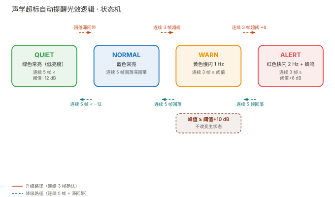
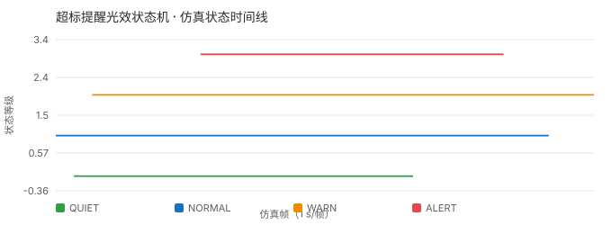

# 课题 06 · 声学超标自动提醒光效逻辑

> 由 `analyze_noise.py` 生成，可并入本目录 README.md。



## 设计目标

校园噪声超标提醒最容易犯的错是「一超就红、一降就绿」——在阈值附近来回跳变，
看的人反而注意不到真正的超标。本套逻辑解决三件事：

1. **不抖**：用「连续 N 帧确认 + 滞回带」把临界波动滤掉；
2. **看得懂**：光效分 4 级，颜色对应严重程度，一眼能判断该不该管；
3. **不漏报**：瞬时峰值（哪怕等效声级还没到阈值）也触发短闪，噪声偶发尖峰不丢。

## 阈值分级

| 时段 | 阈值 | 说明 |
|---|---|---|
| 早 07:00–09:00 | 55 dB | 教学区管理阈值，参考 GB 3096 1 类区昼间 |
| 午 11:00–14:00 | 55 dB | 同上 |
| 晚 20:00–22:00 | 50 dB | 校园自习时段自定收紧 |

> 阈值来源写明：GB 3096-2008《声环境质量标准》1 类区昼间 55 dB 为标准限值；
> 晚间 50 dB 是针对校园晚自习场景的自定收紧值，**不是国标限值**，报告里如实区分。

## 状态机

| 状态 | 光效 | 进入条件 |
|---|---|---|
| QUIET | 绿色常亮（低亮度） | 连续 5 帧低于 阈值−12 dB |
| NORMAL | 蓝色常亮 | 连续 5 帧回落到 阈值−3 dB 滞回带内 |
| WARN | 黄色慢闪 1 Hz | 连续 3 帧 平均声级 ≥ 阈值 |
| ALERT | 红色快闪 2 Hz + 蜂鸣 | 连续 3 帧 ≥ 阈值+6 dB |

- 升级确认 3 帧、降级确认 5 帧、滞回带 3.0 dB，防止临界抖动
- 瞬时峰值 ≥ 阈值+10.0 dB 触发单次短闪，不改变主状态
- 采样周期 1 s，取滑动 60 s 等效声级；装置可用 ESP32-S3 + WS2812 灯环实现
- 状态机实现见 `analyze_noise.py` 的 `LightAlertFSM` 类，**是可运行代码而非伪代码**

### 三个关键参数为什么这么定

| 参数 | 取值 | 理由 |
|---|---|---|
| 升级确认帧数 | 3 帧（3 s） | 单帧可能撞上关门声、拖椅声；连续 3 帧超阈才算真超标 |
| 降级确认帧数 | 5 帧（5 s） | 比升级慢，是**故意的**——超标后不应立刻降级，给人留出处理时间 |
| 滞回带 | 3.0 dB | 升级线 `阈值`、降级线 `阈值−3 dB` 之间留出空档，两个方向不共用同一条线 |
| 瞬时峰值 | +10 dB | 差 10 dB 的尖峰（关门、刹车）在 A 计权下相当于响度差 10 倍，不能忽略 |



```python
if peak >= limit + 10: emit(PEAK_FLASH)
if leq >= limit:
    up += 1; down = 0
    if up >= 3: state = ALERT if leq >= limit + 6 else WARN
else:
    down = down + 1 if leq < limit - 3 else 0; up = 0
    if down >= 5: state = QUIET if leq < limit - 12 else NORMAL
```

## 仿真结果

- 基于当前 23 组真实数据扩展为 138 帧，状态切换 17 次，峰值短闪 84 次
- 结束状态：`WARN`（黄色慢闪 1 Hz）
- 状态时间线图见 `results/06_alert_timeline.svg`

## 数据边界（面试预判）

- 手机 App 非专业声级计、未做 A 计权校准：全程用同一台 OPPO Reno 15、同一持握高度与朝向，
  在报告中说明系统误差；有条件时用标准声级计做一次对照。
- `H04` 最小 7 dB、`H15` 最小 18 dB 为 App 启动瞬间麦克风未稳定的爬升假值，
  原始记录保留不删不改，平均值仍可参考，最小值不纳入统计。
- 雨天 / 校园活动会抬高食堂与运动场读数，已在 CSV 的 `weather` / `note` 列预留归因字段。
- 状态机当前**未接真实硬件**：仿真用实测数据驱动，光效输出为状态字符串；
  接 WS2812 灯环时把 `LIGHT[state]` 映射成 RGB 与闪烁频率即可，状态机逻辑无需改动。
