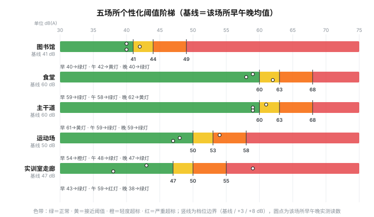

# 课题 06 · 五场所个性化声学提醒光效方案

> 由 `analyze_noise.py` 生成。状态机通用逻辑见 `06_alert_logic.md`，本文给出按场所定制的 5 套阈值与运行方案。

## 一、设计依据

五个点位的声环境本底相差 19 dB（图书馆 41 dB，食堂与主干道 60 dB）。若全用同一条 55 dB 绝对阈值，图书馆终年绿灯、食堂终年红灯，提醒失去意义。

本方案改以**该场所早/午/晚实测均值 B** 为基线，向上叠加固定偏移，判据表达的是「相对该场所正常水平的偏离」，而非跨场所的绝对比较。

偏移档位五场所统一（+3 / +8 / +12 dB），只有基线 B 随场所变化。这样 5 套方案参数可比、可解释；同一台设备换点位后只需改一个基线值。

## 二、五场所基线与阈值

| 场所 | 早 | 午 | 晚 | 均值 | 基线 B | 接近阈值 | 轻度超标 | 严重超标 | 峰值触发 |
|---|---:|---:|---:|---:|---:|---:|---:|---:|---:|
| 图书馆 | 40 | 42 | 40 | 40.7 | **41** | 44 | 49 | >49 | ≥53 |
| 食堂 | 59 | 58 | 62 | 59.7 | **60** | 63 | 68 | >68 | ≥72 |
| 主干道 | 61 | 59 | 59 | 59.7 | **60** | 63 | 68 | >68 | ≥72 |
| 运动场 | 54 | 48 | 47 | 49.7 | **50** | 53 | 58 | >58 | ≥62 |
| 实训室走廊 | 43 | 59 | 38 | 46.7 | **47** | 50 | 55 | >55 | ≥59 |

## 三、五档光效（五场所共用）

| 档位 | 判据（Leq = 滑动 60 s 等效声级） | 光效 | 动作 |
|---|---|---|---|
| 正常 | Leq ≤ B | **绿灯常亮** | 仅上报 |
| 接近阈值 | B < Leq ≤ B+3 | **黄灯常亮** | 上报 + 提示 |
| 轻度超标 | B+3 < Leq ≤ B+8 | **橙灯慢闪 1 Hz** | 上报 + 记录事件 |
| 严重超标 | Leq > B+8 | **红灯快闪 2 Hz + 蜂鸣** | 上报 + 记录 + 现场提醒 |
| 峰值突增 | 瞬时 max ≥ B+12 | **红灯闪一次**（不改变主状态） | 记录峰值时刻与数值 |

升级需连续 3 帧确认、降级需连续 5 帧确认，滞回带 3 dB——与通用状态机同一套防抖参数，避免临界抖动导致灯色反复跳变。

## 四、逐场所方案

### 图书馆（B = 41 dB）

安静阅读区，声环境要求最高。基线 41 dB（早 40 / 午 42 / 晚 40）。不采用国标 55 dB 作警戒线——图书馆的环境恶化通常从 45 dB 量级就已开始，等到 55 dB 早已影响阅读，因此以本底为基线、超 3 dB 即黄灯提示。

- 判定线：≤41 绿常亮｜41–44 黄常亮｜44–49 橙慢闪｜>49 红快闪｜峰值 ≥53 闪一次
- 布点建议：阅览区中央吊顶、避开空调出风口

### 食堂（B = 60 dB）

高声级人声区，本身本底即 60 dB（早 59 / 午 58 / 晚 62）。用 55 dB 绝对阈值会让该点位终年红灯、提醒失效。方案关注「相对用餐常态的叠加」：超 63 dB 提示喧哗，超 68 dB 才判严重。

- 判定线：≤60 绿常亮｜60–63 黄常亮｜63–68 橙慢闪｜>68 红快闪｜峰值 ≥72 闪一次
- 布点建议：售餐窗口上方、距地面 1.5 m

### 主干道（B = 60 dB）

交通与人流混合声，本底 60 dB（早 61 / 午 59 / 晚 59）。早高峰读数 61 dB 落在黄灯区属预期内波动，判据侧重**持续**超标而非瞬时，配合 3 帧升级确认避免车流单次通过误触发。

- 判定线：≤60 绿常亮｜60–63 黄常亮｜63–68 橙慢闪｜>68 红快闪｜峰值 ≥72 闪一次
- 布点建议：人行道侧立柱、朝向车流

### 运动场（B = 50 dB）

开阔活动区，本底 50 dB（早 54 / 午 48 / 晚 47），三时段差异最大（7 dB）。早间晨练使读数抬升，按统一模板会落橙灯——这是真实事件，不是误报；该点位以「夜间休息时段」为管控重点，晚 47 dB 长期处于绿灯区。

- 判定线：≤50 绿常亮｜50–53 黄常亮｜53–58 橙慢闪｜>58 红快闪｜峰值 ≥62 闪一次
- 布点建议：看台或场边立杆、避开扩音

### 实训室走廊（B = 47 dB）

教学过渡区，本底 47 dB（早 43 / 午 59 / 晚 38），日内波动达 21 dB。午间下课时段人流集中，实测 59 dB 会触发红灯——这是本方案对该点位的主要局限，优化方向见第六节。

- 判定线：≤47 绿常亮｜47–50 黄常亮｜50–55 橙慢闪｜>55 红快闪｜峰值 ≥59 闪一次
- 布点建议：走廊中段、避开实训设备门口

## 五、实测回放（15 格数据驱动）

| 场所 | 时段 | 读数 dB | 档位 | 光效 |
|---|---|---:|---|---|
| 图书馆 | 早 | 40 | NORMAL | 绿灯常亮 |
| 图书馆 | 午 | 42 | WATCH | 黄灯常亮 |
| 图书馆 | 晚 | 40 | NORMAL | 绿灯常亮 |
| 食堂 | 早 | 59 | NORMAL | 绿灯常亮 |
| 食堂 | 午 | 58 | NORMAL | 绿灯常亮 |
| 食堂 | 晚 | 62 | WATCH | 黄灯常亮 |
| 主干道 | 早 | 61 | WATCH | 黄灯常亮 |
| 主干道 | 午 | 59 | NORMAL | 绿灯常亮 |
| 主干道 | 晚 | 59 | NORMAL | 绿灯常亮 |
| 运动场 | 早 | 54 | WARN | 橙灯慢闪 1 Hz |
| 运动场 | 午 | 48 | NORMAL | 绿灯常亮 |
| 运动场 | 晚 | 47 | NORMAL | 绿灯常亮 |
| 实训室走廊 | 早 | 43 | NORMAL | 绿灯常亮 |
| 实训室走廊 | 午 | 59 | ALERT | 红灯快闪 2 Hz + 蜂鸣 |
| 实训室走廊 | 晚 | 38 | NORMAL | 绿灯常亮 |

15 格实测落在：绿 10 格、黄 3 格、橙 1 格、红 1 格。

## 六、局限与优化

1. **基线用全日均值，对日内波动大的场所偏严**。实训室走廊三时段为 43 / 59 / 38 dB，午间下课人流使其偏离均值 12 dB，被判红灯。该点位若长期部署，建议改为「同时段历史基线」（午间单独取 55 dB），或对午间加 +6 dB 时段偏置。
2. **基线需定期重标定**。学期初与考试周的人流差异会整体抬升本底，建议每月用连续 3 天数据重算一次 B。
3. **未做 A 计权校准**。全部读数来自同一台手机 App，系统误差在场所间保持一致，因此「相对偏离」的判据比「绝对声级」更可靠。
4. **峰值判据的边界**：瞬时 max 反映的是单次尖峰（关门、拖椅、刹车），与 Leq 超标不是同一类事件，故只闪一次并记录，不参与状态升级。

## 七、运行方案（硬件）

| 环节 | 参数 |
|---|---|
| 采样 | 1 Hz，麦克风 I2S 数字输出，A 计权 |
| 平滑 | 滑动 60 s 等效声级 Leq；峰值取 1 s 内 max |
| 判据 | 各场所独占基线 B，四档阈值 B / B+3 / B+8 / B+12 |
| 防抖 | 升级 3 帧确认、降级 5 帧确认、滞回带 3 dB |
| 输出 | WS2812 灯环：绿/黄常亮、橙 1 Hz、红 2 Hz + 蜂鸣；峰值单闪 |
| 记录 | 状态切换与峰值事件写入本地 Flash，按场所+时段分文件 |
| 主控 | ESP32-S3，5 个点位共用同一固件，仅基线表不同 |

代码实现：`analyze_noise.py` 的 `LightAlertFSM`（通用四态）与 `tier_of()`（五档判定），两者共用同一套防抖参数。
