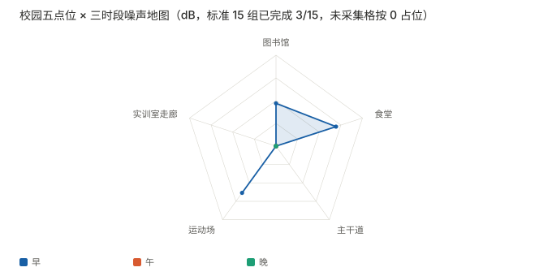
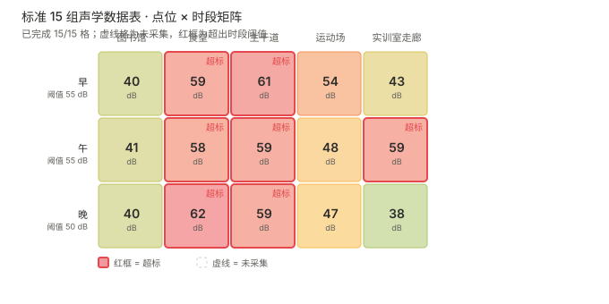
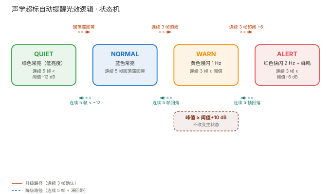
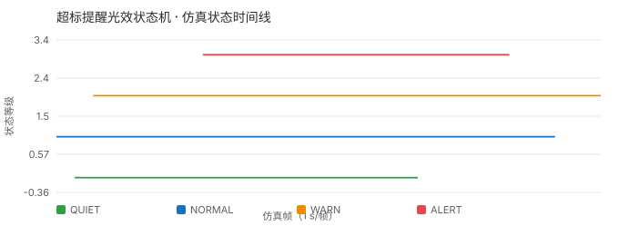

# 课题 06 · 校园声学测量原始材料说明

**设备**：OPPO Reno 15 ＋「分贝仪噪音检测 PLW110」App（导出含 GPS 地点、检测时间、min/max/avg 的报告）
**现场证据**：水印相机 JPG + MP4（含日期、时刻、地点），与报告 PNG 按文件名对应
**采集日期**：11-04、11-05、11-13、11-18、11-19、11-20
**项目起点**：11-01（项目三目录测得低速/高速/受阻三份报告，见第四节）

> `noise_log.csv` 的 `photo` / `report_png` 两列统一写成 `课题06/xxx` 路径。
> 报告时间以 App「检测时间」为准，已逐张与现场水印时刻核对，两者吻合。
> 文件按原始导出名保留，未改名。

---

## 一、实测报告登记

### 11-19 晚间三份（补登记，归入标准格）

| 编号 | 报告文件 | 检测时间 | 点位 | min/max/avg | 现场水印核对 |
|---|---|---|---|---|---|
| H17 | `11-19晚上图书馆 (2).jpg` | 20:34 | 图书馆 | 37/58/40 | 水印 20:34，地点「深圳城市职业学院图书馆」，逐秒吻合 |
| H19 | `11-19晚上主干道 (2).jpg` | 20:41 | 主干道 | 49/71/59 | 水印 20:40，地点「学院干道」，差 1 分钟（先测量后拍照） |
| H18 | `11-19晚上操场 (2).jpg` | 20:49 | 运动场 | 40/68/47 | 水印 20:49，地点「学院操场」，吻合 |

三份均落在晚 20:00–22:00 窗口内，按 R1/R2/R4 归入 N06 / N08 / N09。

### 11-20 补采十份

| 编号 | 报告文件 | 检测时间 | 点位 | min/max/avg | 归类 |
|---|---|---|---|---|---|
| N11 | `11-20早上图书馆.png` | 08:27 | 图书馆 | 38/49/40 | 标准格（早） |
| N12 | `11-20早上饭堂.png` | 08:16 | 食堂 | 53/73/59 | 标准格（早，超标） |
| N14 | `11-20早上操场.png` | 08:20 | 运动场 | 45/70/54 | 标准格（早） |
| H10 | `11-20早上实验室左边 (2).jpg` | 08:32 | 实验室走廊左 | 42/58/48 | 佐证 |
| H11 | `11-20早上实验室右边 (2).jpg` | 08:33 | 实验室走廊右 | 39/53/43 | 标准格 N15（早·实训室走廊） |
| H12 | `11-20早上主干道（校内） (2).jpg` | 09:02 | 主干道校内 | 47/67/52 | 佐证（超出早间窗口） |
| H13 | `11-20早上主干道（校外） (2).jpg` | 08:42 | 主干道校外 | 54/78/61 | 标准格 N13（早·主干道，超标） |
| H14 | `11-20中午主干道（校内） (2).jpg` | 12:31 | 主干道校内 | 48/79/59 | 标准格 N03（午·主干道，超标） |
| H15 | `11-20中午主干道（校外） .jpg` | 12:36 | 主干道校外 | **18**/76/60 | 佐证（超标；最小值为启动假值） |
| H16 | `11-20晚上主干道（校内）.png` | 17:58 | 主干道校内 | 47/64/51 | 佐证（未达晚间窗口） |

### 11-18 四组（H06–H09）

| 编号 | 报告文件 | 检测时间 | 现场水印点位 | min | max | avg | 时长 |
|---|---|---|---|---:|---:|---:|---:|
| H06 | `11-18中午操场 (2).jpg` | 11:44 | 操场（水印 11:43） | 44 | 57 | 48 | 19 s |
| H07 | `11-18中午食堂 (2).jpg` | 12:40 | 百味园食堂（水印 12:39） | 53 | 77 | 58 | 19 s |
| H08 | `11-18晚上主干道.png` | 17:10 | 学院干道（水印 17:09） | 54 | 67 | 59 | 19 s |
| H09 | `11-18晚上食堂.png` | 20:40 | 百味园食堂（水印 20:39） | 53 | 79 | 62 | 28 s |

H08 检测时刻 17:10 属下午，未达官网晚间 20:00–22:00，只作佐证。

### 11-04 / 11-05 / 11-13 六组（H01–H04、H05L、H05）

| 编号 | 报告文件 | 检测时间 | 点位 | min | max | avg | 时长 |
|---|---|---|---|---:|---:|---:|---:|
| H01 | `11-4下午图书馆一楼.png` | 11/04 17:46 | 图书馆一楼 | 36 | 54 | 41 | 36 s |
| H02 | `11-4晚上实验室走廊左边.png` | 11/04 20:32 | 实验室走廊左 | 35 | 46 | 39 | 16 s |
| H03 | `11-4晚上实验室走廊右边.png` | 11/04 20:33 | 实验室走廊右 | 35 | 44 | 38 | 20 s |
| H04 | `11-5中午图书馆一楼..png` | 11/05 11:50 | 图书馆一楼 | **7** | 53 | 41 | 30 s |
| H05L | `11-13中午实验室走廊左边 .jpg`（末尾带空格） | 11/13 11:41 | 实验室走廊左 | 55 | 70 | **60** | 15 s |
| H05 | `11-13中午实验室走廊右边.png` | 11/13 11:42 | 实验室走廊右 | 55 | 66 | **59** | 27 s |

11-13 在实验室走廊拍了左右两个方向的水印照与 MP4，两个方向各导出一份报告（时间相差 1 分钟、与水印对应），共 2 组数据。

### 报告场景标签说明

App 报告自动生成的场景描述（食堂写「汽车穿梭在马路上」、干道写「吵闹的餐厅」、操场写「室内谈话」）是按分贝数值套用的固定文案，与测量点位无关。GPS 落到校外公司附近（171/173 米）为校园边缘的定位漂移。点位一律以带时间地点的现场水印照为准，报告原文未改。

报告检测时间与现场水印时刻全部吻合（通常相差 1 分钟内，即拍完照随即导出报告），未发现文件名与内容对调。

---

## 二、文件对应关系

| 组 | 报告 | 现场 JPG | 视频 MP4 |
|---|---|---|---|
| H01 | `11-4下午图书馆一楼.png` | `11-4下午图书馆一楼.jpg` | `11-4下午图书馆一楼.mp4` |
| H02 | `11-4晚上实验室走廊左边.png` | `11-4晚上实验室走廊左边.jpg` | `11-4晚上实验室走廊左边.mp4` |
| H03 | `11-4晚上实验室走廊右边.png` | `11-4晚上实验室走廊右边.jpg` | `11-4晚上实验室走廊右边.mp4` |
| H04 | `11-5中午图书馆一楼..png` | `11-5中午图书馆一楼.jpg` | `11-5中午图书馆一楼..mp4` |
| H05L | `11-13中午实验室走廊左边 .jpg`（带空格，报告） | `11-13中午实验室走廊左边.jpg` | `11-13中午实验室走廊左边.mp4` |
| H05 | `11-13中午实验室走廊右边.png` | `11-13中午实验室走廊右边.jpg` | `11-13中午实验室走廊右边.mp4` |
| H06 | `11-18中午操场 (2).jpg` | `11-18中午操场.jpg` | `11-18中午操场.mp4` |
| H07 | `11-18中午食堂 (2).jpg` | `11-18中午食堂.jpg` | `11-18中午食堂.mp4` |
| H08 | `11-18晚上主干道.png` | `11-18晚上主干道.jpg` | `11-18晚上主干道.mp4` |
| H09 | `11-18晚上食堂.png` | `11-18晚上食堂.jpg` | `11-18晚上食堂.mp4` |

**易混淆文件**：`11-13中午实验室走廊左边.jpg`（346 KB，现场照）与 `11-13中午实验室走廊左边 .jpg`（118 KB，文件名末尾带空格，是分贝报告）。两者内容不同，带空格那份已作为 H05L 计入数据表。

---

## 三、项目起点的三份分贝报告（11/01）

仓库最早的分贝实测在项目三目录，日期 11/01（比课题 06 首测早 3 天，为 git 建仓当天），是低速/高速/受阻工况的环境声级交叉佐证：

| 报告文件 | 检测时间 | 最小 | 最大 | 平均 | 曲线时长 |
|---|---|---:|---:|---:|---:|
| `02_Stage2_Project_Vibration/低速.png` | 11/01 16:49 | 47 | 58 | **52** | 19 s |
| `02_Stage2_Project_Vibration/高速.png` | 11/01 16:50 | 43 | 62 | **57** | 38 s |
| `02_Stage2_Project_Vibration/受阻.png` | 11/01 16:55 | 44 | 72 | **61** | 38 s |

三份检测地点均在「将军帽路1号深圳技师学院西北约 252–254 米」，时间相隔 1 / 5 分钟，属同一次连续测量。平均声级 52 → 57 → 61 dB 随工况递增，与风扇转速及进风受阻的物理预期一致，是独立于 FFT 分类的交叉佐证。当日记录见 [process_logs/2026-11-01.md](../../process_logs/2026-11-01.md)。

---

## 四、标准 15 格归位

`../noise_log.csv` 中 `N01–N15` 为标准格，`R01` 为 H04 的对照格（未测）。归位由 [tools/build_standard_grid.py](../../tools/build_standard_grid.py) 完成，四条规则：

| 规则 | 内容 |
|---|---|
| R1 时段合规 | 检测时刻落在早 07:00–09:00 / 午 11:00–14:00 / 晚 20:00–22:00 |
| R2 点位合规 | 与官网 5 点位对应：运动场 = 操场；实训室走廊 = 实验室走廊（见 4.2） |
| R3 同格多候选 | 优先取 min ≥ 15 dB（排除启动假值）者，并列取检测时间最早者；与声级高低无关 |
| R4 数值处理 | 从来源记录逐字段复制，不做平均、修正或再加工 |

| 标准格 | 时段 | 点位 | min/max/avg dB | 来源 |
|---|---|---|---|---|
| N11 / N12 / N14 | 早 | 图书馆 / 食堂 / 运动场 | 38/49/40 · 53/73/59 · 45/70/54 | 11-20 直采 |
| N15 / N13 | 早 | 实训室走廊 / 主干道 | 39/53/43 · 54/78/61 | H11 / H13 |
| N01 / N02 / N03 | 午 | 图书馆 / 食堂 / 主干道 | 7/53/41 · 53/77/58 · 48/79/59 | H04 / H07 / H14 |
| N04 / N05 | 午 | 运动场 / 实训室走廊 | 44/57/48 · 55/66/59 | H06 / H05 |
| N07 / N10 | 晚 | 食堂 / 实训室走廊 | 53/79/62 · 35/44/38 | H09 / H03 |
| N06 / N08 / N09 | 晚 | 图书馆 / 主干道 / 运动场 | 37/58/40 · 49/71/59 · 40/68/47 | H17 / H19 / H18 |

### 4.1 门牌证据

现场照片 `11-4晚上实验室走廊右边.jpg` 中门牌可读「426 产业项目实训室」与「425 智能制造实训室」。官网大纲写明 426 为「实践工坊」，门牌与官网同址，据此确认该走廊即官网要求的「实训室走廊」点位。其余走廊现场照（11-13、11-20）水印地点为「深圳城市职业学院实验室」，走廊形制一致。

门牌只能证明走廊属实训楼，不能证明左右两段为同一测点；归位按 R3 统一取右段（H05 / H03 / H11），左段（H05L / H02 / H10）留作佐证。

### 4.2 其他边界

- H15 最小 18 dB、H04 最小 7 dB 为 App 启动爬升假值，平均值可用、最小值不进统计；N01 用 H04 的均值与峰值（官网只要这两项），最小值仍标注为假值。
- H08（17:10）、H16（17:58）文件名标「晚」，检测时刻未达 20:00–22:00，只作佐证、不占标准格。
- 主干道校内/校外为同一点位的两个位置，按 R1 取一份入格，另一份留佐证。

自检：`python 02_Stage2_Project_Vibration\analyze_real_wav.py --check` 报「标准 15 组 15/15」。

---

## 五、分析结果与复现

```bat
cd /d C:\Users\wangy\Desktop\project-03-vibration-diagnosis
python tools\build_standard_grid.py                    :: 归位标准 15 格（幂等）
python 01_Stage1_Field_Measurement\analyze_noise.py    :: 出图 + 光效逻辑
```

### 5.1 噪声地图雷达图



读法：五轴 = 五点位，三折线 = 早/午/晚；径向刻度 30 → 70 dB（中心为 30 dB，环境背景噪声本身高于 30 dB）；虚线为时段阈值（早/午 55 dB、晚 50 dB），折线越线即超标；每点标注实测平均声级，数值相近时自动错开。

15 格平均声级（dB(A)）：

| 时段 | 图书馆 | 食堂 | 主干道 | 运动场 | 实训室走廊 |
|---|---|---|---|---|---|
| 早 | 40 | 59 | 61 | 54 | 43 |
| 午 | 41 | 58 | 59 | 48 | 59 |
| 晚 | 40 | 62 | 59 | 47 | 38 |

超标集中在食堂与主干道（三个时段全部超标）；实训室走廊与图书馆全天最安静。

### 5.2 矩阵热力图



红框格 = 超出时段阈值，虚线格 = 未采集（当前无）。雷达图呈现昼夜形状，矩阵图呈现完成度与超标分布。

### 5.3 光效状态机





阈值早/午 55 dB、晚 50 dB；四态 `QUIET 绿常亮 → NORMAL 蓝常亮 → WARN 黄慢闪 1 Hz → ALERT 红快闪 2 Hz + 蜂鸣`；升级连续 3 帧确认、降级连续 5 帧确认、3 dB 滞回带防抖。完整说明见 [results/06_alert_logic.md](../results/06_alert_logic.md)。

### 5.4 产物清单

| 文件 | 内容 |
|---|---|
| `../results/06_summary.csv` | 23 次独立实测汇总、超标判定、限值 |
| `../results/06_noise_bars.svg` | 各记录平均声级柱状图 |
| `../results/06_noise_radar.svg` | 5 点位 × 3 时段雷达图，15 格全有值 |
| `../results/06_noise_matrix.svg` | 矩阵热力图，超标格红框 |
| `../results/06_alert_fsm.svg` | 光效状态机转移图 |
| `../results/06_alert_timeline.svg` | 状态仿真时间线 |
| `../results/06_alert_logic.md` | 状态机伪代码、参数取值、仿真结果 |

**局限**：手机 App 非专业声级计，未做 A 计权校准，存在系统误差；结论仅用于同一设备下的相对比较，不作绝对声环境合规判定。
