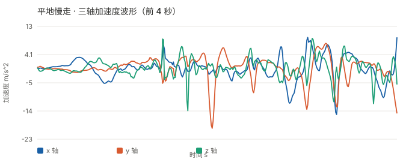
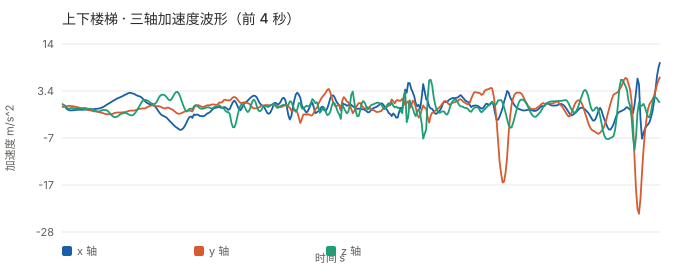
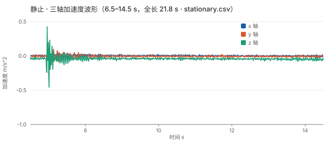
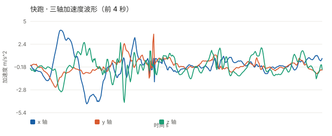
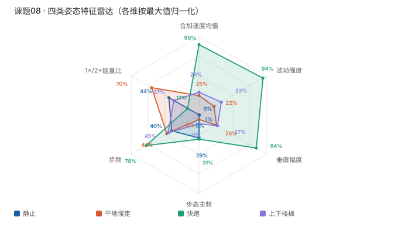
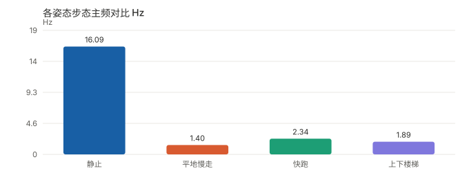

# 课题 08 · 原始步态加速度数据字典

**采集**：2026-11-16 17:02–17:16（UTC+08:00，见各组 `meta/time.csv`）；快跑 11-19 重采
**设备**：静止/慢走/爬楼梯两组用 iPhone17,2（iOS 27.0）；快跑重采用 iPhone18,3（iOS 26.1）；phyphox 1.2.1
**实验**：`Acceleration (without g)` 导出的 `Linear Acceleration x/y/z`，已去重力，单位 m/s²
**姿态**：静止、平地慢走、快跑、上下楼梯（额外采快/慢两档）
**证据**：每组 CSV + MP4（App 实时曲线录屏）+ `meta/device.csv` + `meta/time.csv`

机型差异影响幅度类特征（`svm_mean` / `az_range`），数据分列说明。`without g` 数据不再做减 9.81，也不当 g 使用。

---

## 一、目录结构

```
课题08/
├── 静止/          stationary.csv · stationary.mp4 · meta/{device,time}.csv
├── 慢走/          walking.csv    · walking.mp4    · meta/
├── 快跑/          Raw Data.csv   · 2bd3988d….mp4  · meta/     ← 11-19 重采，31.98 s 有效
├── 爬楼梯（慢）/   stairs-slow.csv · stairs-slow.mp4 · meta/
└── 爬楼梯（快）/   stairs-fast.csv · stairs-fast.mp4 · meta/
```

每个姿态目录直属的 CSV 为传感器数据；`meta/` 为元数据，不参与特征提取。

| 列名 | 含义 | 单位 |
|---|---|---|
| `Time (s)` | 实验相对时间（暂停期间不计时） | s |
| `Linear Acceleration x/y/z (m/s^2)` | 三轴线性加速度，已去重力 | m/s² |
| `Absolute acceleration (m/s^2)` | 合加速度 √(x²+y²+z²) | m/s² |

采样间隔中位数 0.0100 s ≈ 100 Hz（范围 0.0096–0.0274 s），无时间倒序、无大段缺失。CSV 末时刻与 `meta/time.csv` 末次 PAUSE 的实验时间差 0.004–0.023 s，导出完整。5 份 `device.csv` MD5 相同，视频均为 592×1280 / 30 fps / HEVC + AAC。

---

## 二、逐组核对

来源：[课题08核对报告.html](../../AI使用报告/第一阶段/课题08核对报告.html)（只读核对，未改动原始文件）。差值为「视频 − CSV」，视频为传感器曲线录屏。

| 组别 | 开始时刻 | CSV 时长 | 视频时长 | 差值 | \|a\| RMS | 峰值 | 步频 Hz | 判定 |
|---|---|---:|---:|---:|---:|---:|---:|---|
| 静止 | 17:02:48 | 21.75 s | 17.93 s | −3.81 s | 0.12 | 2.0 | 3.45* | 配对正确 |
| 慢走 | 17:08:14 | 29.36 s | 31.37 s | +2.01 s | 5.46 | 22.3 | 0.82 | 配对正确；第 2 帧起 UI 遮挡曲线 |
| 快跑（11/16 旧版） | 17:09:35 | 3.88 s | 15.77 s | +11.89 s | 1.93 | 5.2 | 2.08 | 无效（暂停 25.13 s，强度衰减，视频后 11 s 定格） |
| 爬楼梯（慢） | 17:15:53 | 21.95 s | 17.53 s | −4.42 s | 3.47 | 15.8 | 0.83 | 配对正确；16 s 后无动作 |
| 爬楼梯（快） | 17:12:44 | 13.97 s | 15.43 s | +1.46 s | 9.61 | 48.9 | 1.69 | 配对正确 |

\* 静止组自相关仅 0.18，步频数值无物理意义。

快跑 11/19 重采：`Raw Data.csv` 31.98 s / 100 Hz / 无暂停，RMS 17.31、峰值 73.6，逐秒 6–26 s 持续 17–23 m/s²，为有效样本。旧版数值与判定理由以文字留存作过程证据。

数据质量校验：`|a| = √(x²+y²+z²)` 五份 CSV 逐行误差为 0；整行重复数为 0；5 份 CSV 之间无复制粘贴。

**时间依据**：MP4 `creation_time` 为导出时刻，文件修改时间为拷贝时刻，均不可用于对齐；采集时刻只认 `meta/time.csv` 与画面状态栏。录屏与采集独立起停，不做逐秒对齐。

11/16 的三类版本备份在 `../results/archive_1116/`。

---

## 三、分析脚本

在仓库根目录执行：

```bat
python 01_Stage1_Field_Measurement\analyze_gait.py            :: 正式：读本目录真实 CSV，纳入 4 类
python 01_Stage1_Field_Measurement\analyze_gait.py --demo     :: 演示：合成数据写系统临时目录
```

脚本处理：按有效时长 < 12 s 判定无效样本；双向裁剪起止非动作段（保留合加速度均值 ≥ 本文件峰值 25% 的窗口）；某类样本缺失时禁用对应判别分支。阈值由训练窗口自动标定（取两类均值中点），测试窗口不参与。

判别规则：

```python
if svm_mean < 2.462:            静止      # 合加速度趋零
elif svm_mean >= 11.694:        快跑      # 冲击量级高
elif ratio < 1.393:             上下楼梯   # 单脚支撑，垂向力集中 1× 步频
else:                           平地慢走   # 双脚交替，能量落在 2× 步频
```

`ratio` 为 1×/2× 步频能量比：平地走双脚交替、垂向力落在 2× 步频；上下楼单脚支撑、集中在 1× 步频。二者幅度分布重叠（`az_range` 平地 6.4–12.6 g、楼梯 4.4–22.0 g），幅度判据不可分，故采用节奏判据。

产物在 `../results/`：`08_features.csv`、`08_wave_*.svg`（5 张）、`08_radar.svg`、`08_feature_bars.svg`、`08_confusion.svg`、`08_threshold_rules.md`。

---

## 四、可视化结果

**平地慢走**（双脚交替，垂向力落在 2× 步频）：



**上下楼梯**（单脚支撑，垂向力集中在 1× 步频）：



**静止**（基线噪声，无步态周期）：



**快跑**（冲击量级高于慢走与爬楼）：



**四类特征雷达图**：





**混淆矩阵**：


---

## 五、结果

| 项 | 11/22 结果 | 11/21 旧值 | 11/16 旧值（快跑无效时） |
|---|---|---|---|
| 参与姿态 | 4 类齐全 | 4 类齐全 | 3 类（快跑排除） |
| 有效窗口 | 30 个（3 s 窗口，双向裁剪后） | 51 个（2 s 窗口） | 37 个 |
| 重复分层 5 折交叉验证 | **88.3%**（120 次评估） | — | — |
| 留一整份源文件 | **63.3%**（30 窗口） | — | — |
| 单次奇偶划分 | — | 48.0% | 50.0% |
| 主要混淆 | 平地慢走 ↔ 上下楼梯 | 同 | 同 |

改动：新增 `ratio` 判据；窗口 2 s → 3 s 并双向裁剪；验证由单次奇偶划分改为重复分层 5 折（4 种子 × 20 轮）。

两个指标含义不同：88.3% 衡量同次采集内的窗口级可分性（同文件窗口高度相似，偏乐观）；63.3% 为留一整份源文件结果，更接近真实泛化。留出快跑文件正确率 0/7——快跑仅 1 份源文件，训练集不含该类，阈值无从标定。

逐条对照见 [交付清单.md](./交付清单.md)。

---

## 六、已知局限

- 每类仅 1 次采集（快跑为 11/19 重采版），无法估计类内波动；这是 K 折与留一文件结果差距大的直接原因。
- 手机固定位置未写入当天日志；幅度类特征对位置敏感。
- 快跑机型（iPhone18,3）与其余四组（iPhone17,2）不同，幅度特征存在系统差异。
- 静止组幅度趋零时频谱主频无物理意义，脚本靠 `svm_mean` 先隔离静止。
- 上下楼梯类内强度跨 2.4 倍（慢 2.54 ↔ 快 6.89），单次采集无法估计类内方差，是「平地慢走 ↔ 上下楼梯」混淆的主要来源。
