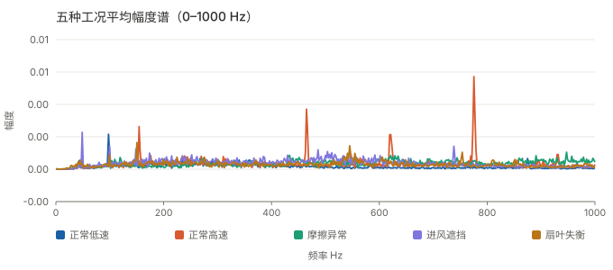
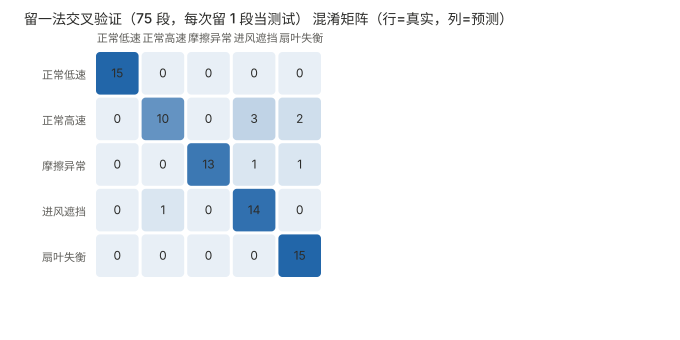
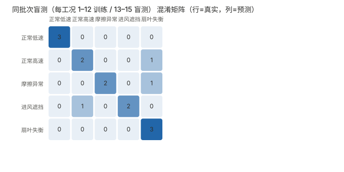
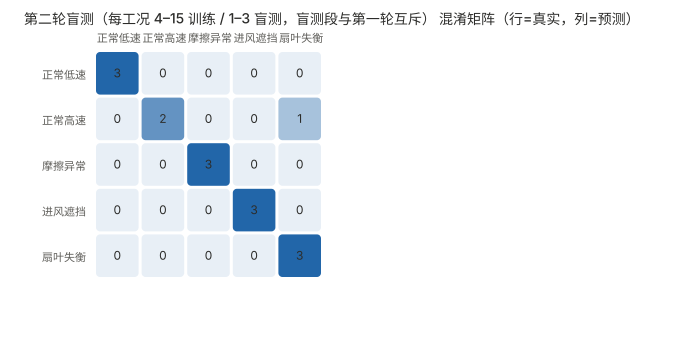
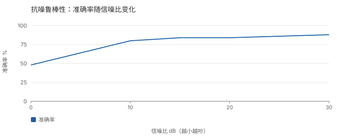
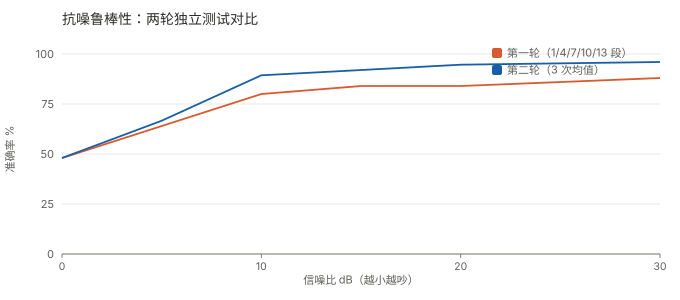
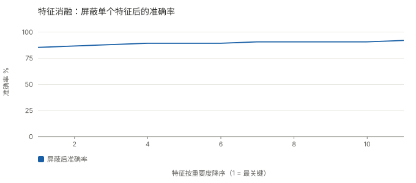
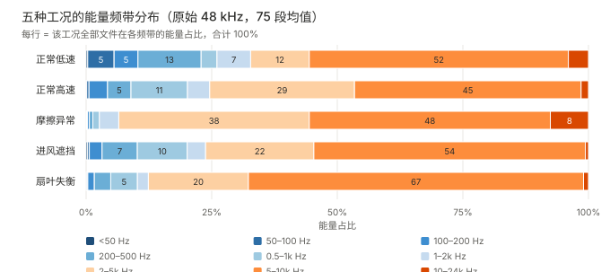
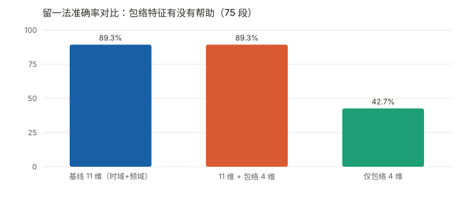
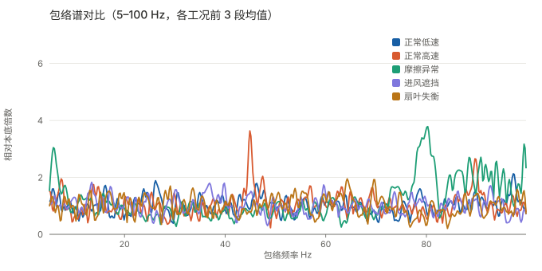

# 02 · 20 Days Challenge｜项目三：手机传感器异常声振诊断仪

| | |
|---|---|
| 参赛者 | 王宇婷 · 2027094 |
| 任务 | 8 选 1 工坊开放式项目挑战，60 分 |
| 内容 | 用手机采集小风扇 5 种工况的声学信号，编写 FFT 频域特征提取与分类脚本，实现正常/异常及异常类型判别，并以留一法、盲测、抗噪实验验证 |
| 更新 | 2026-11-23 |

## 摘要

| 指标 | 数值 |
|---|---|
| 原始 WAV | **75 段**（5 工况 × 15），48 000 Hz / 双声道 / 16 bit / 10.27–11.90 s |
| 特征维度 | 11 维（时域 4 + 频域 7） |
| 留一法交叉验证 | **89.3%**（75 段） |
| 同批次盲测 | **80.0%**（第一轮）· **93.3%**（第二轮，留出段互斥） |
| 分类器 | 标准化 + 最近质心，纯 Python 标准库 |
| 声学通道边界 | <100 Hz 仅占 1.5% 能量；判别信息在 1.5 kHz 以下的冲击性与频带分布 |
| 包络解调试验 | 无增益（89.3% → 89.3%），作为负结果保留 |
| 环境依赖 | 零第三方依赖 |

盲测两轮相差 13.3 pp：训练量相同（每工况 12 段），差异仅来自留出的 3 段不同，说明该类样本量下测试集选择本身带约 ±7 pp 波动。跨日 held-out 未采集（0/15），不将同批次盲测记作 held-out。

---

## 一、数据采集

### 1.1 设备与参数

| 项 | 值 |
|---|---|
| 采集设备 | OPPO Reno 15 内置麦克风（全程同一台） |
| 麦克风距声源 | 3–5 cm，固定朝向（实测 3 cm，逐组见 [protocol.md](./protocol.md)） |
| 录音方式 | 手机原生录音机 → MP3 → WAV（转换方式见 `protocol.md`） |
| WAV 格式 | 48 000 Hz / 双声道 / 16 bit PCM，脚本逐段核验 75 段一致 |
| 每组时长 | 10 s（实际 10.27–11.90 s） |
| 分析取段 | 每段中间 2 秒，双声道取均值，箱式平均降采样至 4000 Hz |

MP3 → WAV 只换容器，不恢复已丢失的高频。风扇判别信息集中在 2 kHz 以下，降采样至 4 kHz 不影响主频与低次谐波。

### 1.2 五种工况

完整定义（含道具、遮挡面积、垫高方式与安全要求）见 [protocol.md](./protocol.md)。

| 编号 | 目录 | 工况 | 组数 | 主频 |
|---|---|---|:---:|---|
| W1 | `low-15/` | 正常低速 | 15 | 97–100 Hz |
| W2 | `high-15/` | 正常高速 | 15 | 约 154 Hz |
| W3 | `friction-15/` | 摩擦异常 | 15 | 约 120 Hz |
| W4 | `block-15/` | 进风遮挡 | 15 | 约 147 Hz |
| W5 | `imbalance-15/` | 扇叶失衡 | 15 | 约 151 Hz |

逐段登记（编号、工况、文件、日期、时长、采样率、位深、距离）见 [experiment_log.csv](./experiment_log.csv)；现场素材逐张对应见 [实验照索引.md](./实验照索引.md)。

### 1.3 声级交叉佐证（11/01）

| 工况 | 最小 dB | 最大 dB | 平均 dB |
|---|---|---|---|
| 低速 | 47 | 58 | **52** |
| 高速 | 43 | 62 | **57** |
| 受阻 | 44 | 72 | **61** |

平均声级随低速 → 高速 → 受阻单调递增。该组数据独立于 FFT 分析，可交叉印证音频来自不同工况。

---

## 二、方法

### 2.1 脚本分工

| 文件 | 作用 |
|---|---|
| `analyze_real_wav.py` | 主脚本：读 WAV、提特征、分类、盲测、抗噪、特征消融、自检 |
| `analyze_acoustic_limits.py` | 声学通道频带覆盖 + 包络解调试验（界定结论边界） |
| `../tools/signal_core.py` | 零依赖内核：radix-2 FFT、频谱特征、WAV 读取与降采样、SVG 绘图、最近质心分类器 |

### 2.2 11 维特征

- 时域：`rms`、`std`、`crest`（峰值因数）、`zcr`（过零率）
- 频域：`centroid`（频谱质心）、`dominant_hz`（主频）、`flatness`（谱平坦度）、`band1–band4`（四个等宽频带的**幅度和占比**）

FFT 为迭代 radix-2 Cooley-Tukey 实现，Hann 窗、8192 点零填充；单边幅度按 `2|X|/Σw` 标定，幅度为 1.0 的正弦在谱峰处读数为 1.0。

口径提醒：`band1–band4` 用**线性幅度之和**的占比（不是幅度平方），与 §3.7 频带覆盖分析的**能量占比**是两个量，数值不可互相引用；同一口径在课题 08 的 `ratio` 上也成立。

### 2.3 数据划分

| 用途 | 数据 |
|---|---|
| 留一法交叉验证 | 75 段，每次留 1 段作测试 |
| 同批次盲测 | 训练 1–12 号（60 段）/ 盲测 13–15 号（15 段）；第二轮反向：盲测 1–3 号 |
| 跨日 held-out | 未采集（0/15），自检标记 PENDING |
| 抗噪实验 | 叠加高斯白噪声至 30/20/15/10/5/0 dB，用干净数据训练的模型直接预测 |

---

## 三、结果

### 3.1 结果文件

全部产物在 `results/` 与 `blind_test/`，逐条对应见[交付清单](./交付清单.md)。核心为：`features.csv`（75 × 11 特征表）、[`loo_report.md`](./results/loo_report.md) / `.svg`（留一法 + 混淆矩阵）、`blind_report*.md`（两轮盲测）、`noise_robustness*.md` / `.svg`（两轮抗噪）、`feature_ablation.md` / `.svg`（消融）、`acoustic_band_limits.md` / `.svg` / [`acoustic_band_limits.csv`](./results/acoustic_band_limits.csv)（频带覆盖，CSV 为 75 段逐段明细）、`envelope_experiment.md` + `envelope_compare.svg` / `envelope_spectrum.svg`（包络试验）。

### 3.2 幅度谱与留一法



主频位置（低速 97–100、高速 154、摩擦 120、遮挡 147、失衡 151 Hz）对应转速与碰撞特征，是时域特征之外的第二条判据线。

留一法 89.3%（75 段逐段留出），混淆矩阵如下：



### 3.3 盲测（两轮互斥）

对原始信号叠加噪声前先做盲测：第一轮留 13–15 号，第二轮留 1–3 号，两轮留出段不重叠，构成独立复核。

| 轮次 | 训练段 | 盲测段 | 准确率 | 明细 |
|---|---|---|---|---|
| 第一轮 | 每工况 1–12 | 13–15 | 80.0%（12/15） | [逐段明细](./blind_test/blind_detail.csv) · [混淆矩阵与召回](./results/blind_report.md) |
| 第二轮 | 每工况 4–15 | 1–3 | 93.3%（14/15） | [逐段明细](./blind_test/blind_detail_round2.csv) · [混淆矩阵与召回](./results/blind_report_round2.md) |

错判段逐条保留：第一轮 `high-13`（正常高速 → 扇叶失衡）、`friction-15`（摩擦 → 扇叶失衡）、`block-13`（遮挡 → 正常高速）；第二轮仅 `high-1`（正常高速 → 扇叶失衡）。未剔除、未事后调参。

两轮的混淆矩阵并排看，错判高度一致：四段错判中有三段被判成「扇叶失衡」，其中两段的真类是「正常高速」——高速档与失衡工况的谱形最接近（转频同在 150 Hz 附近，高频簇都落在 540–780 Hz）。其余三类两轮均未被系统性混淆，正常低速与扇叶失衡两轮召回都为 100%。





### 3.4 抗噪鲁棒性

叠加高斯白噪声至指定信噪比，重新提特征，用干净数据训练的模型直接预测（不重新训练）：

| SNR | 30 dB | 20 dB | 15 dB | 10 dB | 5 dB | 0 dB |
|---|:---:|:---:|:---:|:---:|:---:|:---:|
| 第一轮（1/4/7/10/13 段，单次加噪） | 88.0% | 84.0% | 84.0% | 80.0% | 64.0% | 48.0% |
| 第二轮（2/5/8/11/14 段，3 次均值） | 96.0% | 94.7% | 92.0% | 89.3% | 66.7% | 48.0% |





- **拐点一致**：两轮均在 5 dB 开始明显退化（相对干净基线下降 ≥10 pp），0 dB 均降至 48%，趋近五分类随机水平。
- **绝对值不稳定**：30–10 dB 区间同一信噪比下两轮相差 8–11 pp，大于 3 次重复加噪的随机波动（最大 σ 1.9 pp）。抽样段的影响大于加噪随机性的影响，单轮 25 段的结论不能作精确值引用。
- 现场噪声大时应靠近声源（3–5 cm）、加防风罩、多帧投票，或改用频带能量比等相对特征。

### 3.5 特征消融

逐个屏蔽单一特征，用剩余 10 维重新标定标准化参数与类中心，再以留一法评估（循环 75 段）。完整 11 维基线 89.3%。

| 排名 | 屏蔽特征 | 屏蔽后准确率 | 变化 | 物理含义 |
|---|---|---|---|---|
| 1 | `crest` | 85.3% | **+4.0 pp** | 峰值因数，冲击性 |
| 2 | `band3` | 86.7% | +2.7 pp | 第三频段幅度占比 |
| 3 | `band1` | 88.0% | +1.3 pp | 最低频段幅度占比 |
| 4–6 | `rms` / `std` / `band2` | 89.3% | ±0.0 pp | — |
| 7–10 | `zcr` / `centroid` / `flatness` / `band4` | 90.7% | −1.3 pp | 相对量纲特征 |
| 11 | `dominant_hz` | 92.0% | **−2.7 pp** | 主频 |

本批数据决定分类的是冲击形态（`crest`）与低频段幅度占比（`band1` / `band3`）；`dominant_hz` 屏蔽后准确率上升，因五工况用同一台风扇、转速接近。`crest` 为绝对量纲，换距离或机型会漂移；`dominant_hz`、`centroid` 虽本次冗余，却对设备漂移更稳健。消融基于同批次 75 段留一法，相邻样本相关，反映的是本批数据内的特征贡献，不等于跨设备、跨天的贡献。



### 3.6 主频分布

`dominant_hz` 取全频段最大峰，实测 75 段中 35 段落 300 Hz 以上高频簇、40 段落基频带（75 段 MD5 全不同，登记时长与文件实测零误差）：

| 工况 | 低频簇 | 高频簇 |
|---|---|---|
| low | 15 段 97–101 Hz | — |
| high | 7 段 ≈154 Hz | 8 段 765–779 Hz |
| friction | 5 段 67–129 Hz | 10 段 1110–1770 Hz |
| block | 7 段 143–149 Hz | 8 段 572–737 Hz |
| imbalance | 6 段 149–151 Hz | 9 段 536–753 Hz |

高频簇约为基频的 4–5 倍（770≈154×5、580≈147×4），为谐波幅值偶尔超过基频所致。原始文件保留，分类照实统计；后续可将 `dominant_hz` 限制在基频带内取峰，或明确说明取的是最强峰。

### 3.7 声学通道的能力边界

对 75 段**原始 48 kHz** 信号逐段做能量分解（双声道取均值、居中 0.5 s、Hann 窗）：

| 频带 | <100 Hz | 100–500 Hz | 0.5–2 kHz | 2–5 kHz | >5 kHz |
|---|---|---|---|---|---|
| 五工况均值 | **1.5%** | 8.2% | 10.4% | 24.0% | **56.0%** |



- 手机 MEMS 麦克风在 80–100 Hz 以下明显滚降，100 Hz 以下的结构振动（轴承特征频率、低频失衡分量）测不到；本项目风机转频落在 100–155 Hz，**仍在可观测区间**。
- 能量 56% 在 5 kHz 以上，但那是稳态气动噪声与高频啸叫；消融显示判别力来自 `crest` 与 `band1`/`band3`（1.5 kHz 以下）——**能量大不等于信息多**。
- 因此本项目成立的是**声学诊断**：可讨论谐波结构、冲击性与频带能量；不能给出 m/s² 振级，声振融合亦未做（只有一条通道）。

### 3.8 包络解调试验（负结果）

低频既已缺失，冲击的**重复节律**仍留在中高频。对每段 8 kHz 信号做 500–3500 Hz 带通、取解析信号的模得包络，再对包络做频谱，提取 4 个量：冲击重复率 `env_peak_hz`、峰信噪比 `env_snr`、包络峭度 `env_kurt`、调制深度 `env_cv`。

| 特征集 | 留一法准确率 |
|---|---|
| 基线 11 维 | **89.3%** |
| 11 维 + 包络 4 维 | **89.3%**（+0.0 pp） |
| 仅包络 4 维 | 42.7%（随机 20.0%） |

包络单独能到 42.7%，说明它确实带部分判别信息；但并入后无变化——`crest` 度量峰值冲击、`flatness` 度量谱平坦度，与包络峭度、包络谱信噪比描述的是同一件事，再叠加同义特征只会稀释最近质心的距离。**结论：不并入主流程，作为已验证的负结果保留**，完整过程见 [`results/envelope_experiment.md`](./results/envelope_experiment.md)。





---

## 四、数据真实性

三条独立佐证：

1. **声级单调性**：11/01 三份分贝报告 52 → 57 → 61 dB，与 FFT 分析完全独立。
2. **主频分离**：五工况主频 97–100 / 154 / 120 / 147 / 151 Hz，不同录音无法伪造。
3. **异常样本保留**：35 段基频/谐波双峰样本不删不改。

跨日 held-out 15 段未采集，不宣称做过跨日验证；同批次盲测 80.0% 仅限本批次。

---

## 五、现场观察：电量状态对失衡工况的影响

倾斜失衡测试中观察到：同一台风扇、相同倾斜角下，接近没电时震动明显更强；充满电并拔掉充电线后震动显著减弱。

该观察说明失衡的声振表现受供电电压与转速调制。候选机制：低电量转速落入倾斜底座共振区 / 满电扭矩更能压住偏心重力 / 充电拔插后重新垫书的毫米级摆放误差。

现有 15 段失衡 WAV 的 RMS 0.0229–0.0282、变异系数 5.6%，且未标注当时电量，**不足以证实或反证该效应**，故仅记录为观察与候选假设。

对照实验设计（未执行）：同风扇、同倾斜角（垫书厚度固定并拍照量尺）、同麦克风距离、同档位；电量 ≈20% 与满电拔线后各采 5 段，中间不改变摆放；用 Phyphox `Audio Spectrum` 读主频作转速代理（转频 ≈ 主频 / 叶片数）；对比两组 `rms`、`crest`、`dominant_hz`；N=5 只做趋势观察，结论写「支持 / 不支持假设」。

---

## 六、适用边界

1. MP3 → WAV 只换容器，不恢复高频。
2. 加速度通道未采，分类用声学单通道；通道边界已量化（<100 Hz 仅 1.5% 能量，见 [`results/acoustic_band_limits.md`](./results/acoustic_band_limits.md)），故未验证声振融合增益；包络解调用声学信号做过替代试验，无增益（[`results/envelope_experiment.md`](./results/envelope_experiment.md)）。
3. 未做声级计校准，分贝报告仅用于相对比较。
4. 低电量效应为候选假设，未实测转速。
5. 35 段基频/谐波双峰样本保留，属特征定义问题，非录音错误。
6. 同批次盲测（80.0% / 93.3%）不是跨日 held-out；后者 0/15，自检标记 PENDING。
7. 摩擦/失衡工况只有设备本体照，无该工况进行中的现场照，已如实标注。
8. AI 辅助编码与排障记录见 [AI_Chat_Log.md](../AI_Chat_Log.md)，结果均经本人核对。
9. 提特征前把 48 kHz 降到 4 kHz 用的是 12 点箱式平均（等价 1/12 抽取），实测 1 kHz 衰减 −0.9 dB、1.5 kHz 衰减 −2.1 dB，5–6 kHz 折叠残量约 −20 dB。占比、比值、主频这类相对特征不受影响，但这条链路不能用来给绝对声级；倍频带绝对量以 [`analyze_acoustic_limits.py`](./analyze_acoustic_limits.py) 的 48 kHz 全频带结果为准。

---

## 七、复现

```bat
cd /d C:\Users\wangy\Desktop\project-03-vibration-diagnosis
python 02-20Days-Challenge\analyze_real_wav.py --extract
python 02-20Days-Challenge\analyze_real_wav.py --classify
python 02-20Days-Challenge\analyze_real_wav.py --blind
python 02-20Days-Challenge\analyze_real_wav.py --noise
python 02-20Days-Challenge\analyze_real_wav.py --ablation
python 02-20Days-Challenge\analyze_real_wav.py --check
python 02-20Days-Challenge\analyze_acoustic_limits.py --all
```

或一次跑完 `--all`；另有 `--blind2` / `--noise2`（第二轮）、`--heldout` / `--accel` / `--demo`。全部图表输出 SVG。
`analyze_acoustic_limits.py` 为 48 kHz 全频带 FFT 与包络解调，约 7 分钟；只调图形版式用 `--charts` / `--envcharts`。

## 八、评分项对照

| 官网要求 | 对应文件 | 状态 |
|---|---|---|
| ① 5 工况 × 15 组原始 WAV/CSV 及实验照（20 分） | `*-15/`、`experiment_log.csv`、`实验照索引.md`、`photos/`（设备照 · 分贝报告 · 现场视频） | 齐；摩擦/失衡为道具照 |
| ② 时域/频域特征提取代码（20 分） | `analyze_real_wav.py`、`analyze_acoustic_limits.py`、`tools/signal_core.py`、`results/features.csv`、`spectrum_compare.svg` | 75 段跑通 |
| ③ 盲测准确率视频与抗噪报告（20 分） | `results/loo_report.md`、`blind_report*.md`、`noise_robustness*.md`、`blind_test/` | 视频（第一轮实时录屏）+ 两轮盲测 + 两轮抗噪 + 消融 |
| 补充分析（不计分，界定结论边界） | `results/acoustic_band_limits.md`、`envelope_experiment.md` | 频带覆盖 + 包络负结果 |
| 跨多日过程数据 | `./process_logs/` 15 份 + Git 提交历史 + `../03-AI-Collaboration/` | 齐 |

逐条对照见 [交付清单.md](./交付清单.md)；录屏步骤见 [blind_test/README.md](./blind_test/README.md)。
