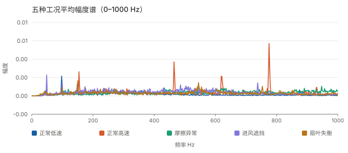
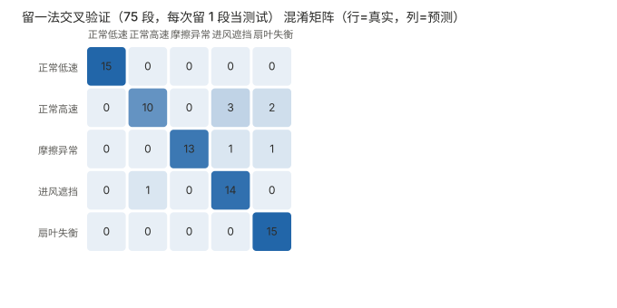
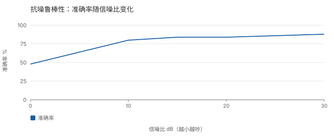
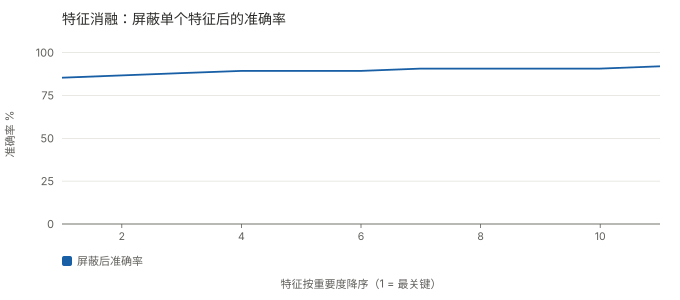

# 第二阶段 · 项目三：手机传感器异常声振诊断仪

**学号**：2027094　**姓名**：王宇婷　**分值**：60 分（工坊开放式项目挑战 8 选 1）　**更新**：2026-11-23

用手机采集小风扇在 5 种工况下的声学信号，编写 FFT 频谱特征提取与分类脚本，实现正常/异常及异常类型判别，并以留一法、盲测与抗噪实验验证。

## 摘要

| 指标 | 数值 |
|---|---|
| 原始 WAV | **75 段**（5 工况 × 15），48 000 Hz / 双声道 / 16 bit / 10.27–11.90 s |
| 特征维度 | 11 维（时域 4 + 频域 7） |
| 留一法交叉验证 | **89.3%**（75 段） |
| 同批次盲测 | **80.0%**（第一轮）· **93.3%**（第二轮，盲测段互斥） |
| 分类器 | 标准化 + 最近质心，纯 Python 标准库 |
| 环境依赖 | 零第三方依赖 |

盲测两轮相差 13.3 pp：训练量相同（每工况 12 段），差异只来自「哪 3 段被留出」，说明每类 15 段时测试集选择本身带来约 ±7 pp 的波动。跨日 held-out 未采集（0/15），不把同批次盲测记作 held-out。

---

## 一、数据采集

### 设备与参数

| 项 | 值 |
|---|---|
| 采集设备 | OPPO Reno 15 内置麦克风（全程同一台） |
| 麦克风距声源 | 3–5 cm，固定朝向（实测 3 cm，逐组见 [protocol.md](./protocol.md)） |
| 录音方式 | 手机原生录音机 → MP3 → WAV 转换（工具见 `protocol.md`） |
| WAV 格式 | 48 000 Hz / 双声道 / 16 bit PCM，脚本逐段核验 75 段一致 |
| 每组时长 | 10 s（实际 10.27–11.90 s） |
| 分析取段 | 每段中间 2 秒，双声道取均值，箱式平均降采样到 4000 Hz |

MP3 → WAV 只换容器，不恢复已丢失的高频。风扇判别信息集中在 2 kHz 以下，降采样到 4000 Hz 不影响主频与低次谐波。

### 五种工况

完整定义见 [protocol.md](./protocol.md)。

| 编号 | 目录 | 中文 | 组数 | 样例主频 |
|---|---|---|:---:|---|
| W1 | `low-15/` | 正常低速 | 15 | 97–100 Hz |
| W2 | `high-15/` | 正常高速 | 15 | 约 154 Hz |
| W3 | `friction-15/` | 摩擦异常 | 15 | 约 120 Hz |
| W4 | `block-15/` | 进风遮挡 | 15 | 约 147 Hz |
| W5 | `imbalance-15/` | 扇叶失衡 | 15 | 约 151 Hz |

逐段登记（编号、工况、文件、日期、时长、采样率、位深、距离）见 [experiment_log.csv](./experiment_log.csv)。现场证据：`day1.jpg`、`day1 (2).jpg`、`day2.jpg`、`低速.png` / `高速.png` / `受阻.png`（分贝报告）、`低速10s.mp4` / `高速10s.mp4` / `受阻10s.mp4`；逐张对应见 [实验照索引.md](./实验照索引.md)。

### 声级交叉佐证（11/01）

| 工况 | 最小 dB | 最大 dB | 平均 dB |
|---|---|---|---|
| 低速 | 47 | 58 | **52** |
| 高速 | 43 | 62 | **57** |
| 受阻 | 44 | 72 | **61** |

平均声级随低速 → 高速 → 受阻单调递增。该组数据独立于 FFT 分析，可交叉印证音频来自不同工况。

---

## 二、方法

### 脚本分工

| 文件 | 作用 |
|---|---|
| `analyze_real_wav.py` | 主脚本：读 WAV、提特征、分类、盲测、抗噪、特征消融、自检 |
| `../tools/signal_core.py` | 零依赖内核：radix-2 FFT、频谱特征、WAV 读取与降采样、SVG 绘图、最近质心分类器 |

### 11 维特征

- 时域：`rms`、`std`、`crest`（峰值因数）、`zcr`（过零率）
- 频域：`centroid`（频谱质心）、`dominant_hz`（主频）、`flatness`（谱平坦度）、`band1–band4`（四个等宽频带能量比）

FFT 为迭代 radix-2 Cooley-Tukey 实现，加 Hann 窗、8192 点零填充。

### 数据划分

| 用途 | 数据 |
|---|---|
| 留一法交叉验证 | 75 段，每次留 1 段当测试 |
| 同批次盲测 | 训练 1–12 号（60 段）/ 盲测 13–15 号（15 段） |
| 跨日 held-out | 未采集（0/15），自检标记 PENDING |
| 抗噪实验 | 叠加高斯白噪声至 30/20/15/10/5/0 dB，用干净数据训练的模型直接预测 |

---

## 三、结果

| 产物 | 内容 |
|---|---|
| `results/features.csv` | 75 行 × 11 维特征表 |
| `results/spectrum_compare.svg` | 五工况平均幅度谱（0–1000 Hz） |
| `results/loo_report.md` / `.svg` | 留一法 89.3% + 混淆矩阵 + 每类召回 |
| `results/blind_report.md` / `.svg` | 第一轮盲测 80.0% + 混淆矩阵 |
| `results/blind_report_round2.md` | 第二轮盲测 93.3%（1–3 号盲测、4–15 号训练） |
| `results/盲测两轮对比说明.md` | 两轮对照、差异成因、错判方向 |
| `results/noise_robustness.md` / `.svg` | 第一轮抗噪曲线、分档准确率 |
| `results/noise_robustness_round2.md` / `.svg` | 第二轮抗噪：换抽样段 + 3 次重复加噪，两轮曲线对比 |
| `results/feature_ablation.md` / `.svg` | 11 维特征逐个屏蔽后的留一法准确率 |
| `blind_test/blind_detail.csv` · `盲测演示.html` | 第一轮 15 段明细 + 演示页（12/15 = 80.0%，视频即此轮实时录屏） |
| `blind_test/blind_detail_round2.csv` | 第二轮 15 段明细（14/15 = 93.3%） |

### 五工况幅度谱



主频位置（低速 ~97–100 Hz、高速 154 Hz、摩擦 120 Hz、遮挡 147 Hz、失衡 151 Hz）对应风扇转速与碰撞特征，是时域特征之外的第二条判据线。

### 留一法混淆矩阵



### 抗噪鲁棒性

对原始信号叠加高斯白噪声至指定信噪比，重新提特征，用干净数据训练的模型直接预测（不重新训练）：

| SNR | 30 dB | 20 dB | 15 dB | 10 dB | 5 dB | 0 dB |
|---|:---:|:---:|:---:|:---:|:---:|:---:|
| 第一轮（1/4/7/10/13 段，单次加噪） | 88.0% | 84.0% | 84.0% | 80.0% | 64.0% | 48.0% |
| 第二轮（2/5/8/11/14 段，3 次均值） | 96.0% | 94.7% | 92.0% | 89.3% | 66.7% | 48.0% |

第二轮换用另一组抽样段，并对每个信噪比重复 3 次不同随机种子的加噪。两轮结论：

- **拐点一致**：都在 5 dB 开始明显退化（相对干净基线下降 ≥10 pp），0 dB 均降到 48%，趋近五分类随机水平。
- **绝对值不稳定**：30–10 dB 区间同一信噪比下两轮相差 8–11 pp，远大于 3 次重复的随机波动（最大标准差 1.9 pp）。即抽样段的影响大于加噪随机性的影响——单轮 25 段的结论不能当成精确值报。
- 现场噪声大时需靠近声源（3–5 cm）、加防风罩、多帧投票，或改用频带能量比等相对特征。



### 特征消融

对每个特征单独屏蔽，用剩余 10 维重新标定标准化参数与类中心，再以留一法评估（循环 75 段）。完整 11 维基线为 89.3%。

| 排名 | 屏蔽的特征 | 屏蔽后准确率 | 变化 | 物理含义 |
|---|---|---|---|---|
| 1 | `crest` | 85.3% | **+4.0 pp** | 峰值因数，冲击性 |
| 2 | `band3` | 86.7% | +2.7 pp | 第三频段能量 |
| 3 | `band1` | 88.0% | +1.3 pp | 最低频段能量 |
| 4–6 | `rms` / `std` / `band2` | 89.3% | ±0.0 pp | — |
| 7–10 | `zcr` / `centroid` / `flatness` / `band4` | 90.7% | −1.3 pp | 相对量纲特征 |
| 11 | `dominant_hz` | 92.0% | **−2.7 pp** | 主频 |

本次数据中决定分类的是冲击形态（`crest`）与低频段能量（`band1` / `band3`）；`dominant_hz` 屏蔽后准确率上升，因五个工况用同一台风扇、转速接近，差异主要体现在碰撞冲击与频带能量分布。`crest` 为绝对量纲，换距离或机型会漂移；`dominant_hz`、`centroid` 虽本次冗余，却对设备漂移更稳健。

消融基于同批次 75 段留一法，同文件相邻样本仍高度相关，反映本次数据内的特征贡献，不等于跨设备、跨天的贡献。



### 主频分布

`dominant_hz` 取全频段最大峰，实测 75 段中 35 段落 300 Hz 以上高频簇、40 段落基频带（75 段 MD5 全不同，登记时长与文件实测零误差）：

| 工况 | 低频簇 | 高频簇 |
|---|---|---|
| low | 15 段 97–101 Hz | — |
| high | 7 段 ≈154 Hz | 8 段 765–779 Hz |
| friction | 5 段 67–129 Hz | 10 段 1110–1770 Hz |
| block | 7 段 143–149 Hz | 8 段 572–737 Hz |
| imbalance | 6 段 149–151 Hz | 9 段 536–753 Hz |

高频簇约为基频的 4–5 倍（770≈154×5、580≈147×4），为谐波幅值偶尔超过基频所致。原始文件保留，分类照实统计；后续可将 `dominant_hz` 限制在基频带内取峰，或明确说明取的是最强峰。

---

## 四、数据真实性

三条独立佐证：

1. **声级单调性**：11/01 三份分贝报告 52 → 57 → 61 dB，与 FFT 分析独立。
2. **主频分离**：五工况主频 97–100 / 154 / 120 / 147 / 151 Hz，不同录音无法伪造。
3. **异常样本保留**：35 段基频/谐波双峰样本不删不改。

跨日 held-out 15 段未采集，不宣称做过跨日验证；同批次盲测 80.0% 仅限本批次。

---

## 五、现场观察：电量状态对失衡工况的影响

倾斜失衡测试中观察到：同一台风扇、相同倾斜角下，接近没电时震动明显更强；充满电并拔掉充电线后，震动显著减弱。

该观察说明失衡的声振表现受供电电压与转速调制。候选机制：低电量转速落入倾斜底座共振区 / 满电扭矩更能压住偏心重力 / 充电拔插后重新垫书的毫米级摆放误差。

现有 15 段失衡 WAV 的 RMS 0.0229–0.0282、变异系数 5.6%，且未标注当时电量，**不足以证实或反证该效应**，故仅记录为观察与候选假设。

对照实验设计（未执行）：同风扇、同倾斜角（垫书厚度固定拍照量尺）、同麦克风距离、同档位；电量≈20% 与满电拔线后各采 5 段，中间不改变摆放；用 Phyphox `Audio Spectrum` 读主频作转速代理（转频 ≈ 主频 / 叶片数）；对比两组 `rms`、`crest`、`dominant_hz`；N=5 只做趋势观察，结论写「支持/不支持假设」。

---

## 六、局限

1. MP3 → WAV 只换容器，不恢复高频。
2. 加速度通道未采，分类用声学单通道，未验证声振融合增益。课题 08 已采 5 组三轴加速度 CSV，证明通道可行；补采设备与声学设备不同，分列记录。
3. 未做声级计校准，分贝报告仅用于相对比较。
4. 低电量效应为候选假设，未实测转速。
5. 35 段基频/谐波双峰样本保留，属特征定义问题，非录音错误。
6. 同批次盲测（80.0%）不是跨日 held-out；后者 0/15，自检标记 PENDING。
7. 摩擦/失衡工况只有设备本体照，无该工况进行中的现场照，已如实标注。
8. AI 辅助编码与排障记录见 [AI_Chat_Log.md](../AI_Chat_Log.md)，结果均经本人核对。

---

## 七、复现

```bat
cd /d C:\Users\wangy\Desktop\project-03-vibration-diagnosis
python 02_Stage2_Project_Vibration\analyze_real_wav.py --extract
python 02_Stage2_Project_Vibration\analyze_real_wav.py --classify
python 02_Stage2_Project_Vibration\analyze_real_wav.py --blind
python 02_Stage2_Project_Vibration\analyze_real_wav.py --noise
python 02_Stage2_Project_Vibration\analyze_real_wav.py --ablation
python 02_Stage2_Project_Vibration\analyze_real_wav.py --check
```

或一次跑完：`--all`。另可用 `--heldout` / `--accel` / `--demo`。全部图表输出 SVG。

## 八、官网评分对照

| 官网要求 | 对应文件 | 状态 |
|---|---|---|
| ① 5 工况 × 15 组原始 WAV/CSV 及实验照（20 分） | `*-15/`、`experiment_log.csv`、`实验照索引.md`、`day*.jpg`、`*.png`、`*.mp4` | 齐；摩擦/失衡只有设备本体照 |
| ② 时域/频域特征提取代码（20 分） | `analyze_real_wav.py`、`tools/signal_core.py`、`results/features.csv`、`spectrum_compare.svg` | 已跑通 75 段 |
| ③ 盲测准确率视频与抗噪报告（20 分） | `results/loo_report.md`、`blind_report.md`、`blind_report_round2.md`、`noise_robustness.md`、`noise_robustness_round2.md`、`blind_test/` | 视频（第一轮实时录屏）、两轮盲测、两轮抗噪、消融齐 |
| 跨多日过程数据 | `../process_logs/` 15 份 + Git 提交历史 + `../AI使用报告/` | 齐 |

逐条对照见 [交付清单.md](./交付清单.md)；录屏步骤见 [blind_test/README.md](./blind_test/README.md)。
