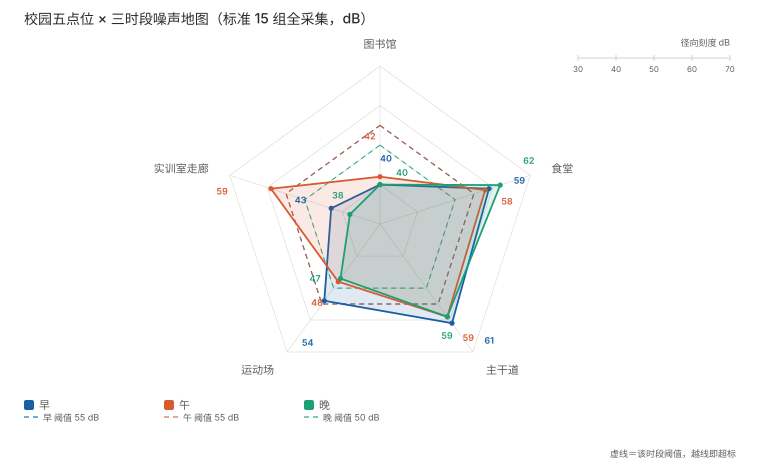
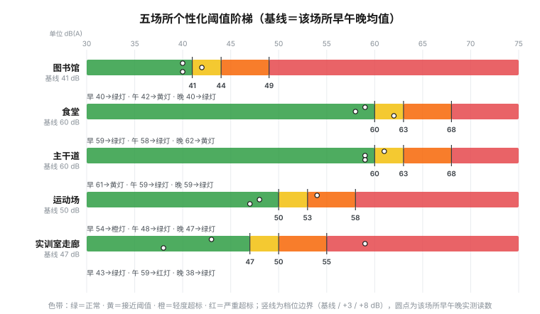
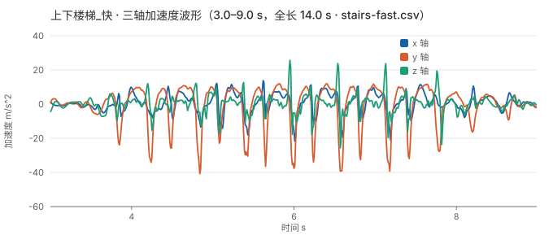
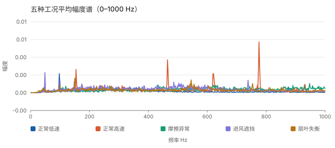
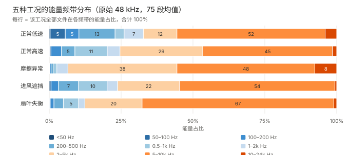

# ICEC 2026 级选拔 · 过程数据仓库

| | |
|---|---|
| 参赛者 | 王宇婷 · 学号 2027094 · 2026 级高职 人工智能 |
| 周期 | 2026-11-01 → 2026-11-23（逐日提交，过程见 `02-20Days-Challenge/process_logs/`） |
| 选题 | 第一阶段 课题 06 + 课题 08（10 选 2，20 分）；第二阶段 项目三（8 选 1，60 分） |
| 目录 | 按官网建议组织：`01-Field-Discovery/`（阶段一报告与 `raw_data/`）、`02-20Days-Challenge/`（源码、`process_logs/` 与实物演进照）、`03-AI-Collaboration/`（AI 协作记录） |
| 技术栈 | Python 3 标准库（`csv` `wave` `struct` `math` `cmath`），零第三方依赖，图表输出 SVG |

---

## 一、任务与结论

| 选题 | 交付要求 | 本仓库结论 |
|---|---|---|
| 课题 06 校园昼夜声学噪声地图测绘 | 15 组声学数据表、雷达图、声学超标自动提醒光效逻辑 | 标准 15 格全部有实测值（早/午/晚各 5/5）；23 组纳入统计，其中 11 组超时段阈值；光效按 5 个场所各自基线标定，15 格回放绿 10 · 黄 3 · 橙 1 · 红 1 |
| 课题 08 多姿态步态加速度特征采集与对比 | 4 份原始 CSV 波形、可视化图、区分动作的阈值规则 | 5 组 100 Hz 三轴 CSV（楼梯分快/慢两档）；四类判别规则，重复分层 5 折 **88.3%**、留一整份源文件 **63.3%** |
| 项目三 手机传感器异常声振诊断仪 | 5 工况 × 15 组序列及实验照；时域/频域特征提取代码；盲测视频与抗噪报告 | 75 段 48 kHz WAV 齐全；11 维特征；留一法 **89.3%**，两轮盲测 **80.0% / 93.3%**，抗噪拐点两轮同为 **5 dB** |

技术链：**现场采集 → 可解释特征 → 标准化 + 最近质心分类 → 留一法 / 盲测 / 抗噪三级验证**。全部指标可由仓库内脚本重跑复现，无一条依赖外部服务或预训练模型。

## 二、交付索引

| 内容 | 位置 |
|---|---|
| 第一阶段总报告 | [01-Field-Discovery/README.md](./01-Field-Discovery/README.md) |
| ├ 课题 06 原始材料与数据登记 | [06-acoustic/README.md](./01-Field-Discovery/06-acoustic/README.md) |
| └ 课题 08 数据字典与逐组核对 | [08-gait/README.md](./01-Field-Discovery/08-gait/README.md) · [交付清单](./01-Field-Discovery/08-gait/交付清单.md) |
| 第二阶段项目三主报告 | [02-20Days-Challenge/README.md](./02-20Days-Challenge/README.md) |
| 项目三配套 | [交付清单](./02-20Days-Challenge/交付清单.md) · [工况定义](./02-20Days-Challenge/protocol.md) · [实验照索引](./02-20Days-Challenge/实验照索引.md) |
| 盲测演示 | [演示页](./02-20Days-Challenge/blind_test/盲测演示.html) · [录屏说明](./02-20Days-Challenge/blind_test/README.md) · [逐段明细](./02-20Days-Challenge/blind_test/blind_detail.csv) |
| AI 使用记录 | [截图与核对报告](./03-AI-Collaboration/README.md) · [文字索引](./AI_Chat_Log.md) |
| 过程日志 | [process_logs/README.md](./02-20Days-Challenge/process_logs/README.md)（15 份） |
| 任务排期 / 提交操作 | [DAILY_PLAN.md](./DAILY_PLAN.md) · [提交指引.md](./提交指引.md) |

## 三、方法

| 环节 | 实现 | 关键参数 |
|---|---|---|
| 采集（声学） | OPPO Reno 15 内置麦克风 + 分贝 App「分贝仪噪音检测 PLW110」 | 48 000 Hz / 双声道 / 16 bit；距声源 3–5 cm；同机同持握高度 1.2 m |
| 采集（加速度） | iPhone17,2 + phyphox 1.2.1，`Acceleration (without g)` | 100 Hz 三轴，已去重力，单位 m/s² |
| 特征 | 手写迭代 radix-2 FFT（Hann 窗、8192 点零填充）+ 时域统计量 | 项目三 11 维（时域 4 + 频域 7）；课题 08 10 维（含步频与 1×/2× 能量比） |
| 分类 | 标准化 + 最近质心；课题 08 为单阈值判定树 | 阈值由训练窗口标定，测试集不参与 |
| 验证 | 留一法 → 同批次盲测（两轮互斥）→ 抗噪压力测试 | 抗噪 SNR 30/20/15/10/5/0 dB；课题 08 另做留一整份源文件 |

## 四、主要结果

| 指标 | 数值 | 口径 / 出处 |
|---|---|---|
| 课题 06 标准格 | **15/15** | 早/午/晚 × 5 点位，每格均有实测，[`06_summary.csv`](./01-Field-Discovery/results/06_summary.csv) |
| 课题 06 实测与超标 | 24 组实测 / 23 组纳入统计；11 组超标（食堂 3 · 主干道 6 · 实训室走廊 2） | 超时段阈值（早/午 55、晚 50 dB）；标准 15 格中 7 格超标 |
| 课题 06 场所化光效 | 基线 41 / 60 / 60 / 50 / 47 dB；四档绿黄橙红 + 峰值单闪 | 15 格回放绿 10 · 黄 3 · 橙 1 · 红 1，[`06_alert_profiles.md`](./01-Field-Discovery/results/06_alert_profiles.md) |
| 课题 08 判别准确率 | K 折 **88.3%** / 留一文件 **63.3%** | 30 窗口；前者为窗口级可分性，后者近泛化，[`08_threshold_rules.md`](./01-Field-Discovery/results/08_threshold_rules.md) |
| 项目三数据规模 | 75 段 WAV（5 工况 × 15），10.27–11.90 s | 48 kHz / 双声道 / 16 bit，75 段 MD5 互异 |
| 项目三留一法 | **89.3%** | 75 段逐段留出，[`loo_report.md`](./02-20Days-Challenge/results/loo_report.md) |
| 项目三盲测 | 第一轮 **80.0%**（12/15）· 第二轮 **93.3%**（14/15） | 两轮留出段互斥，[`盲测两轮对比说明.md`](./02-20Days-Challenge/results/盲测两轮对比说明.md) |
| 项目三抗噪 | 30→0 dB：88.0→48.0%（一轮）· 96.0→48.0%（二轮） | 拐点两轮均为 5 dB，[`noise_robustness_round2.md`](./02-20Days-Challenge/results/noise_robustness_round2.md) |
| 特征消融 | `crest` 最关键（屏蔽后 −4.0 pp），`dominant_hz` 冗余（屏蔽后 +2.7 pp） | 屏蔽重标定 + 留一法，[`feature_ablation.md`](./02-20Days-Challenge/results/feature_ablation.md) |
| 声学通道边界 | <100 Hz 占 1.5% 能量，>5 kHz 占 56.0%；1× 转频 100–155 Hz 可观测 | 75 段原始 48 kHz 分解，[`acoustic_band_limits.md`](./02-20Days-Challenge/results/acoustic_band_limits.md) |
| 包络解调试验 | 89.3% → 89.3%（+0.0 pp），仅包络 42.7% | 负结果，未并入主流程，[`envelope_experiment.md`](./02-20Days-Challenge/results/envelope_experiment.md) |

**读法**：88.3% 与 63.3% 不可互换——前者衡量同一次采集内 3 s 窗口的可分性（相邻窗口高度相关，偏乐观），后者训练与测试不共享源文件。盲测两轮相差 13.3 pp，训练量相同（每工况 12 段），差异仅来自留出的 3 段不同，说明该类样本量下测试集选择本身带约 ±7 pp 波动。抗噪两轮拐点一致而绝对值相差 8–11 pp，量级大于 3 次重复加噪的随机波动（最大 σ 1.9 pp）。各项差异均写入对应报告，不以单次最优值对外表述。

## 五、关键图表

**课题 06 · 五点位 × 三时段噪声地图**（五轴为点位，三折线为时段，虚线为时段阈值）：



**课题 06 · 五场所个性化阈值阶梯**（每行一个场所，色带即四档区间，圆点为实测读数）：



**课题 08 · 步态波形**（取活动段中部 8 s，标题标注区间与源文件）：



**项目三 · 五工况平均幅度谱**：



**项目三 · 声学通道能量频带分布**（低频缺失的直接证据，支撑第四章的边界结论）：



## 六、仓库结构

```
project-03-vibration-diagnosis/
├── README.md · DAILY_PLAN.md · AI_Chat_Log.md · 提交指引.md
├── 01-Field-Discovery/                    阶段一 · 实地测评（课题 06 + 课题 08）
│   ├── README.md                          阶段一总报告
│   ├── raw_data/                          原始件：不改名、不裁剪、不删
│   │   ├── noise_log.csv                  N01–N15 标准格 + H01–H20 / H05L 登记
│   │   ├── acoustic/                      分贝报告 PNG + 现场 JPG/MP4（73 件）
│   │   └── gait/                          5 组姿态 CSV + meta（20 件）
│   ├── 06-acoustic/README.md              课题 06 材料登记、逐张核对、15 格归位
│   ├── 08-gait/                           README.md · 交付清单.md
│   ├── results/                           06_* 图表与光效方案 · 08_* 波形与阈值 · archive_1116/
│   └── analyze_noise.py · analyze_gait.py
├── 02-20Days-Challenge/                   20 天挑战 · 项目三（源码 + 原始数据 + 过程）
│   ├── README.md · protocol.md · 交付清单.md · 实验照索引.md · experiment_log.csv
│   ├── analyze_real_wav.py · analyze_acoustic_limits.py
│   ├── low-15/ · high-15/ · friction-15/ · block-15/ · imbalance-15/   75 段 WAV
│   ├── photos/                            day1/day2 设备照 · 三份分贝报告 · 三段现场视频
│   ├── blind_test/                        演示页 + 录屏说明 + 逐段明细 + 视频
│   ├── process_logs/                      15 份逐日日志 + 索引
│   └── results/                           特征表 / 频谱 / 留一法 / 盲测 / 抗噪 / 消融 / 频带边界 / 包络试验
├── 03-AI-Collaboration/                   三阶段对话截图 + 课题 08 核对报告
└── tools/                                 signal_core.py（FFT/绘图/分类内核）· build_standard_grid.py
                                           normalize_text.py · make_templates.py · make_blind_demo.py
```

## 七、评分项对照

**第二阶段（60 分）**，逐条见[项目三交付清单](./02-20Days-Challenge/交付清单.md)：

| 官网要求 | 对应内容 | 状态 |
|---|---|---|
| ① 5 工况 × 15 组原始 WAV/CSV 及实验照（20 分） | `*-15/` 75 段 WAV、`experiment_log.csv`、`photos/`（day1/day2 设备照 · 三份分贝报告 · 三段现场视频）、`实验照索引.md` | 数据齐全；摩擦/失衡为道具照，无动作瞬间同框（已标注） |
| ② 时域/频域特征提取代码（20 分） | `02-20Days-Challenge/analyze_real_wav.py`、`tools/signal_core.py`、`results/features.csv`、`results/spectrum_compare.svg` | 75 段跑通 |
| ③ 盲测准确率视频与抗噪报告（20 分） | `02-20Days-Challenge/blind_test/`、`results/loo_report.md`、`blind_report*.md`、`noise_robustness*.md`、`feature_ablation.md` | 视频（第一轮实时录屏）+ 两轮盲测 + 两轮抗噪 + 消融 |
| 跨多日过程数据 | `02-20Days-Challenge/process_logs/` 15 份、Git 提交历史、`03-AI-Collaboration/` | 齐（含 3 天空白模板，未补写） |
| AI 协作记录 | `03-AI-Collaboration/` 截图 + 核对报告 + `AI_Chat_Log.md` | 齐 |

**第一阶段（20 分）**：`01-Field-Discovery/raw_data/noise_log.csv`（标准格 15/15 + 8 组佐证）、`01-Field-Discovery/results/06_*`、`01-Field-Discovery/raw_data/gait/` 5 组 CSV、`01-Field-Discovery/results/08_*`；逐条见[课题 08 交付清单](./01-Field-Discovery/08-gait/交付清单.md)。

## 八、数据口径与边界

**统计口径**（三处文档一致，脚本自检同步输出）

- 课题 06：24 组独立实测，其中 23 组纳入统计（15 组归入标准格、8 组为佐证）；`H04` 因最小值 7 dB 为 App 启动爬升假值降级为排障样本，不计入。
- 项目三：75 段全部纳入；留一法逐段留出，盲测两轮各留 15 段且互斥。

**设备分列**：课题 06 与项目三声学通道用 OPPO Reno 15；课题 08 用 iPhone17,2 + phyphox 1.2.1，11/19 快跑重采用 iPhone18,3。幅度类特征存在系统差异，不跨机型直接比较。

**原始数据**：音频、照片、视频均为本人实地采集，原件保留不删不改；MP3 → WAV 仅换容器，不恢复已丢失高频。

**异常与无效样本**：11-05 的 7 dB、11-20 的 18 dB 判为启动假值，保留记录并标注，平均值可用、最小值不进统计；课题 08 快跑 11/16 旧版（3.88 s、暂停 25.13 s）判无效，数值与理由以文字留存，11/19 重采后纳入。

**时间依据**：分贝数据以 App「检测时间」为准，逐张与现场水印核对；加速度以 `meta/time.csv` 与画面状态栏为准。文件系统时间与 MP4 `creation_time` 均为拷贝/封装时刻，不作采集时间。

**归位规则**：标准 15 格由 `tools/build_standard_grid.py` 按四条预先声明的规则归位（时段窗口、点位对应、同格择优、数值不加工），与声级高低无关，幂等可复现。

**适用边界**

1. 跨日 held-out 未采集（0/15），自检标记 PENDING；现有 80.0% / 93.3% 均为同批次盲测，不宣称跨日泛化。
2. 项目三仅声学单通道，声振融合未验证；通道边界已量化（<100 Hz 占 1.5% 能量，1× 转频 100–155 Hz 可观测），缺的是低频结构振动。
3. 课题 08 每类仅 1 次采集（快跑为 11/19 重采版），无法估计类内波动，是 K 折与留一文件差距大的直接原因。
4. 手机 App 非专业声级计，未做 A 计权校准，读数仅用于同机相对比较。

**AI 使用**：按官网要求允许并鼓励，记录见 `03-AI-Collaboration/` 与 `AI_Chat_Log.md`；数据采集、结论判断与代码核对均由本人完成。

## 九、进度记录

> 仅记有据可查的事实（文件、时间戳、Git 提交）；无产出的日期如实留空。

| 日期 | 完成内容 |
|---|---|
| 11/01 | 项目三预实验：低速/高速/受阻分贝报告（平均 52/57/61 dB）；建仓 |
| 11/02–03 | 目录与 README、`AI_Chat_Log.md`；上传 D2 声学预调研素材 |
| 11/04 | 课题 06 首测三组（图书馆 41、走廊左 39、走廊右 38 dB）；项目三 low/high/friction 各 15 组 |
| 11/05 | 课题 06 图书馆 11:50（7/53/41），7 dB 判为启动假值；该组 11-23 已重测替代 |
| 11/06 | 项目三补 block / imbalance 各 15 组，5 工况齐全；记录低电量震动观察（未做对照） |
| 11/13 | 搭建 Python / Phyphox / GitHub 环境；课题 06 补测走廊左右（60/59 dB） |
| 11/14–15 | 空模板，无当日产出 |
| 11/16 | 课题 08 采 5 组三轴加速度；完成 CSV ↔ 视频核对；输出 3 类版阈值规则（50.0%） |
| 11/17 | 空模板；held-out 与加速度通道未采 |
| 11/18 | 项目三 4 类整合、抗噪、消融、盲测演示页与录屏（12/15 = 80.0%）；课题 06 增 H06–H09 |
| 11/19 | 逐张核对分贝报告时间与水印；补录 H05L；课题 08 快跑重采（31.98 s / 100 Hz / 无暂停） |
| 11/20 | 课题 06 补采 10 份报告，3 份填标准格 N11/N12/N14，7 份登记佐证 |
| 11/21 | 全量复核；两处脚本由文件名判定改为按时长判定；更正主频说明为基频/谐波双峰 |
| 11/22 | 课题 08 判据升级（K 折 48.0% → 88.3%）；课题 06 改 5×3 矩阵、增热力图与时间线；标准格归位 3/15 → 12/15 → 15/15；特征消融；编码与换行规范化 |
| 11/23 | 课题 06 重测图书馆午间（12:19，38/48/42），N01 改用 H20，原 7 dB 组降为排障样本；新增五场所光效方案；课题 08 波形改取活动段中部并修图，补标定法对比；项目三第二轮盲测 93.3%、第二轮抗噪；补声学通道频带覆盖与包络试验 |

## 十、复现

在仓库根目录执行（Windows `cmd`）：

```bat
python tools\signal_core.py                  :: 内核自检
python tools\build_standard_grid.py          :: 标准 15 格归位（幂等）
python 01-Field-Discovery\analyze_noise.py
python 01-Field-Discovery\analyze_gait.py
python 02-20Days-Challenge\analyze_real_wav.py --all
python 02-20Days-Challenge\analyze_real_wav.py --blind2 --noise2
python 02-20Days-Challenge\analyze_acoustic_limits.py --all
python tools\make_blind_demo.py
python 02-20Days-Challenge\analyze_real_wav.py --check
python tools\normalize_text.py
```

耗时与替代：`analyze_acoustic_limits.py --all` 为 48 kHz 全频带 FFT 与包络解调，约 7 分钟，只调图形版式时用 `--charts` / `--envcharts`；`analyze_gait.py --demo` 的合成产物写入系统临时目录，不落仓库、不作结论依据。
